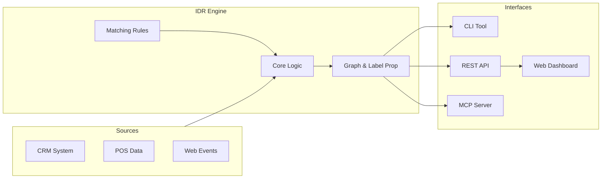

# 🔗 SQL Identity Resolution

[](https://github.com/anilkulkarni87/sql-identity-oss/actions/workflows/test.yml)
[](https://anilkulkarni87.github.io/sql-identity-oss/)
[](https://opensource.org/licenses/Apache-2.0)
[](https://github.com/anilkulkarni87/sql-identity-oss/stargazers)

[](https://www.snowflake.com/)
[](https://cloud.google.com/bigquery)
[](https://databricks.com/)
[](https://duckdb.org/)

**Headless, warehouse-native deterministic identity resolution** for modern data warehouses. Unify customer identities across CRM, transactions, web events, and loyalty data via CLI, Python, dbt, FastAPI, or Remote MCP (`/mcp`)—with an optional Explorer UI. **Zero data movement. No ML required.**

## ⚡ 60-Second Demo

```bash
# Install and run
pip install "sql-identity-resolution[duckdb,api,mcp]"
idr quickstart
```

That's it! The engine will:
1. Generate **10,000 synthetic records**
2. Initialize a local DuckDB warehouse
3. Run the resolution pipeline
4. Output identity clusters and statistics

## 🎯 Why SQL Identity Resolution?

| Challenge | Our Solution |
|-----------|--------------|
| **Expensive CDPs** | Open source, runs on your warehouse |
| **Black-box ML** | Deterministic rules, fully auditable |
| **Vendor lock-in** | Same logic across 4 platforms |
| **Scale limits** | Tested to 100M+ rows |

## ✨ Key Features

- **Unified Core Package (`v0.7.0`)** - Headless-first execution via `idr_core`, CLI, Python, and `dbt_idr`
- **🤖 Agent-Native MCP Server & Zero-PII AI Copilot** - 23 MCP tools + `/mcp` Streamable HTTP, built-in **AI Copilot (`⌘K`)** with local Ollama (zero data movement) or Cloud BYOK (automatic PII masking), and **AI Suggest Config** statistical schema profiler
- **🖥️ Crisp Daylight / Dark Engineering Workbench (`idr ui`)** - Precision 4-tab Identity Studio, focused `Run Pipeline` slide-over drawer, 7:5 Graph-left / Tabbed Inspector-right Explorer with collapsible Crosswalk Lineage table, Multi-Lens views & cross-lens diff matrix, and one-click GDPR Forget
- **🪝 Event Webhooks** - Non-blocking `run.completed`, `guardrail.skipped_groups_spike`, and `privacy.erasure_completed` hooks
- **🎯 Confidence Scoring & Multi-Lens Identity Views** - Continuous cluster quality metrics (`0.0–1.0`) and policy-scoped identity lenses (`strict_person`, `household`, `b2b_account`) evaluated in a single extraction pass
- **🔒 Ephemeral Dry Run & Config Versioning** - Preview draft YAML/UI rule changes (`--config ... --dry-run`) with hash equi-join `Edges Delta`, `Clusters Delta`, & corroborating-edge shadow attribution without mutating `idr_meta.*`, plus `idr config history` / `idr config rollback`
- **⚡ Dialect-Optimized Warehouse Engine** - Canonical `CLUSTER BY` table definitions across BigQuery, Snowflake, and Databricks (with zero-downtime BigQuery clustering auto-migration), pointer ping-pong Label Propagation, and single-query metadata joins

## 📊 Architecture



## 🚀 Getting Started

### Option 1: CLI (Standard)

The `idr` CLI is the standard way to run on all platforms.

```bash
# 1. Initialize DB
idr init --platform [duckdb|bigquery|snowflake|databricks] --db demo.duckdb

# 2. Configure (using YAML; legacy alias `idr apply-config` also supported)
idr config apply --platform [platform] --db demo.duckdb --file examples/config_retail.yaml

# 3. Preview a draft YAML without saving config or mutating output tables
idr run --platform [platform] --db demo.duckdb --mode FULL --config candidate.yaml --dry-run

# 4. Run Pipeline (FULL or INCR) & manage config history/rollback
idr run --platform [platform] --db demo.duckdb --mode FULL
idr config history --platform [platform] --db demo.duckdb
idr config rollback --platform [platform] --db demo.duckdb

# 4. Launch Interactive Web UI + API
idr ui --db demo.duckdb
```

### Option 2: AI Agent (MCP) & Local Ollama / BYOK AI Assistant

Enable your AI assistant (Antigravity, Codex, Cursor, Claude) to understand and query your identity graph via MCP, **or** use the built-in AI Assistant with **local Ollama** (zero data movement) or any BYOK model (OpenAI, Anthropic, Gemini) with automatic PII masking:

```bash
# Built-in AI Assistant (local Ollama on MacBook/Linux)
ollama pull llama3.2
idr ai test --provider ollama --model llama3.2
idr ai ask --db my_warehouse.duckdb "How many multi-entity clusters exist?"
idr explain <resolved_id> --db my_warehouse.duckdb
idr triage --db my_warehouse.duckdb

# Start MCP Server
export IDR_PLATFORM=duckdb
export IDR_DATABASE=./my_data.duckdb
idr mcp
```

See [MCP Documentation](idr_mcp/README.md) or [Interfaces & MCP Guide](docs/interfaces-and-dbt.md#4-fastmcp-server-for-ai-agents-idr-mcp) for Antigravity, Codex, Cursor, and Claude setup guides.

### Option 3: Web UI (`idr ui`)

Launch the full-stack Web UI and FastAPI backend with a single command (opens `http://127.0.0.1:8000` automatically):

```bash
# Single-command UI + API server (serves bundled idr_api/static on port 8000)
idr ui

# Or pre-connect to a specific local DuckDB file
idr ui --db demo.duckdb --port 8000

# Headless API only (without opening browser)
idr serve --port 8000
```

For frontend UI development with Vite hot-module reload (`http://localhost:3000` proxying `/api` to `:8000`):
```bash
# Terminal 1: Start FastAPI backend
idr serve --reload

# Terminal 2: Start Vite dev server (or build static bundle into idr_api/static)
cd idr_ui && npm run dev
# To update the bundled static UI served by `idr ui`:
cd idr_ui && npm run build && rm -rf ../idr_api/static/* && cp -R dist/* ../idr_api/static/
```

Open API docs at http://localhost:8000/docs.

For full UI + API stack:
```bash
docker compose up --build
```
Open http://localhost:3000.

For pinned-image deployment:
```bash
cp .env.example .env
docker compose -f docker-compose.prod.yml --env-file .env up -d
```

## 🏭 Industry Templates

Pre-built configurations for common use cases:

| Template | Use Case | Identifiers |
|----------|----------|-------------|
| [Retail](examples/templates/retail/) | Nike, Lululemon style | email, phone, loyalty_id, address |
| [Healthcare](examples/templates/healthcare/) | Patient matching | MRN, SSN, name+DOB |
| [Financial](examples/templates/financial/) | Account linking | account_id, email, SSN |
| [B2B SaaS](examples/templates/b2b_saas/) | Lead deduplication | email, domain, company_name |

## 🧪 Testing & Production Benchmarks

- **Live Benchmarks (6.3M Entities, 15 Source Tables → 5.38M Edges → 1.54M Clusters)**:
  - **DuckDB (Local)**: **94s (1.6 min)** (~67,000 entities/sec)
  - **Snowflake**: **170s (2.8 min)** (~37,000 entities/sec)
  - **Databricks SQL Warehouse**: **296s (4.9 min)** (~21,300 entities/sec)
  - **Google BigQuery (Serverless)**: **306s (5.1 min)** (~20,600 entities/sec)
  - Detailed stage-by-stage breakdown in [Supported Warehouses & Production Benchmarks](docs/warehouses-and-schema.md#5-production-benchmarks-real-world-runtimes).

```bash
# 1. Run the full unit & multi-dialect test suite
pytest

# 2. Run opt-in live cloud integration tests (when cloud credentials are set)
pytest tests/test_cloud_dialects_live.py -v
```

See [Concepts & Architecture](docs/concepts-and-architecture.md) for detailed pipeline stage and schema design, and the [Downstream Consumption & Reverse-ETL SQL Cookbook](docs/getting-started.md#4-downstream-consumption--reverse-etl-sql-cookbook) for joining `idr_out` tables back to fact tables and incremental exports.

## 🤝 Contributing

We welcome contributions! See [CONTRIBUTING.md](CONTRIBUTING.md) for guidelines.

```bash
# Dev setup
pip install -e ".[dev,duckdb]"
pre-commit install
ruff check .
```

## 📜 License

Apache 2.0 — see [LICENSE](LICENSE)

---

<p align="center">
  <b>⭐ Star this repo if you find it useful!</b>
</p>
