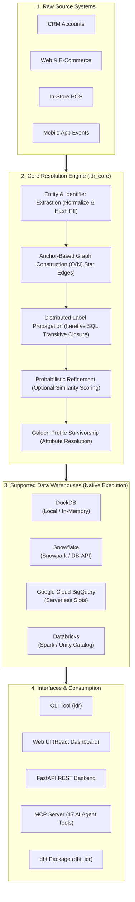

# Overview

**SQL Identity Resolution (`sql-identity-oss`)** is a warehouse-native, deterministic identity resolution and customer 360 engine designed for modern data platforms. It unifies customer profiles across CRM, point-of-sale, e-commerce, mobile, and customer service systems directly inside your data warehouse—**without black-box ML, external SaaS data exports, or vendor lock-in**.

---

## Core Capabilities

### 1. Deterministic-First Graph Construction
- Matches entities using high-confidence identifiers (`email`, `phone`, `loyalty_id`, `device_id`, `account_id`).
- Normalizes values on extraction (e.g., lowercasing, stripping whitespace, or custom SQL expressions).
- Employs an **anchor-based N-1 edge building strategy** to link groups of entities in $O(N)$ edges rather than $O(N^2)$ cross-products.

### 2. High-Cardinality Safeguards
- Configurable `max_group_size` per rule prevents graph explosion from shared or placeholder identifiers (e.g. `support@company.com`, `000-000-0000`).
- Oversized groups are gracefully bypassed and logged to `idr_out.skipped_identifier_groups` for auditing.
- Exact and wildcard blocklists (`idr_meta.identifier_exclusion`) filter out system accounts and junk values before edge formation.

### 3. Distributed Connected-Component Resolution
- Graph clusters are resolved in pure SQL via iterative **Label Propagation**.
- Satisfies formal mathematical graph invariants:
  - **Partition Completeness**: Every entity belongs to exactly one cluster.
  - **Connected-Component Completeness**: 0 edges cross distinct clusters.
  - **Minimum-Label Determinism**: `resolved_id` is deterministically the minimum `entity_key` in the component.

### 4. Optional Probabilistic Refinement
- When `--strict` mode is disabled, optional fuzzy matching rules (e.g., Jaro-Winkler, Levenshtein, Metaphone) group resolved clusters into higher-level **Super-Clusters** (`super_cluster_id`).
- Pre-filtering blocking keys ensure fuzzy string comparisons remain performant at scale.

### 5. Automated Golden Record Survivorship
- Constructs unified 360° customer profiles (`idr_out.golden_profiles`) according to declarative attribute survivorship strategies:
  - **`RECENCY`**: Most recent non-null value based on timestamp/watermark.
  - **`PRIORITY`**: Highest-ranked source system wins (e.g., CRM > POS > Web), with null-penalization.
  - **`FREQUENCY`**: Most common value across all cluster entities.

---

## Getting Started Paths

| Path | Audience | Primary Tool | Documentation |
|---|---|---|---|
| **Zero-Config Local Demo** | Evaluators & Developers | `idr quickstart` | [Quickstart Guide](03-quickstart.md) |
| **Interactive Visual Setup** | Data Engineers & Analysts | Web UI (`idr serve` / Docker) | [Web UI Guide](09-ui.md) |
| **Warehouse Pipelines** | Production CI/CD & Orchestration | `idr` CLI / Python SDK | [CLI Reference](05-cli.md) & [Platforms](06-platforms.md) |
| **AI Assistants & Agents** | Claude Desktop, Cursor, MCP Clients | `idr mcp` (FastMCP) | [MCP Server Guide](11-mcp.md) |
| **dbt-First Teams** | Analytics Engineers using dbt | `dbt_idr` package | [dbt Integration](12-dbt.md) |
