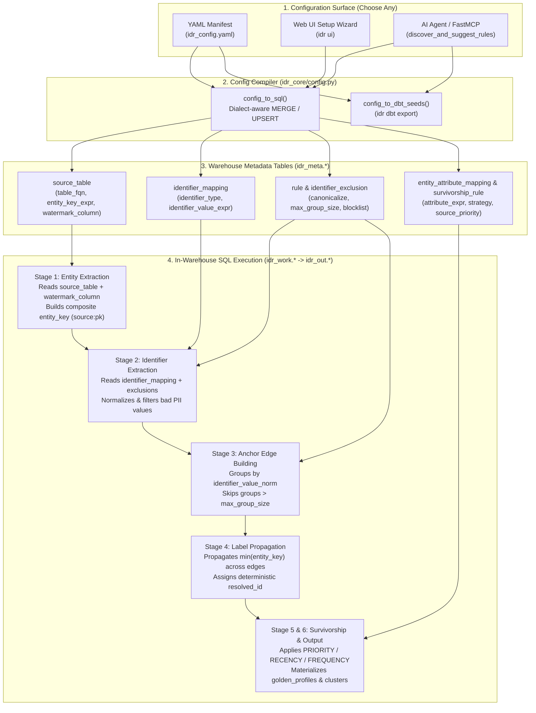

# Configuration Guide: Mental Model, Core Fields & Runtime Lifecycle

IDR configurations can be authored as a declarative YAML manifest (`idr_config.yaml`), configured visually through the **6-Step Web UI Setup Wizard** (`idr ui`), or generated automatically by an AI agent via FastMCP (`discover_and_suggest_rules`).

Regardless of how you create it, the configuration defines **four core concepts**:

1. **Primary Keys (`entity_key`)** — How to uniquely identify each raw row.
2. **Watermark Columns (`watermark_column`)** — How to track incremental changes and recency.
3. **Identifiers (`identifiers`)** — Which columns link records together into identity clusters.
4. **Attributes (`attributes` & `survivorship`)** — Which columns populate the unified Golden Profile.

---

## 🧠 Core Concepts Explained

### 1. Primary Key (`entity_key`) & Source ID (`id`)

Every source table must specify a short `id` (e.g., `"crm"`, `"orders"`, `"pos"`) and an `entity_key` column or SQL expression (e.g., `"customer_id"`, `"order_id"`).

* **Why it is required:** Different source systems frequently use auto-incrementing integers (`1, 2, 3...`) that would collide if pooled together.
* **How the app uses it:** During extraction, IDR combines `id` and `entity_key` into a globally unique composite node key formatted as `<source_id>:<entity_key>`:
  * Row `1042` in `raw.crm_customers` (`id: "crm"`) becomes **`crm:1042`**
  * Row `1042` in `raw.web_orders` (`id: "orders"`) becomes **`orders:1042`**
* **Deterministic & Persistent Cluster ID (`resolved_id`):**
  * On the initial run, IDR deterministically assigns the lexicographically smallest `entity_key` in a connected component (e.g., `crm:1042`) as the cluster's `resolved_id`.
  * **Cross-Run Persistence:** On subsequent runs, if new entities join an existing cluster (even if a new entity has a lexicographically smaller key like `aaa:001`), IDR **locks and preserves** the cluster's existing `resolved_id` (`crm:1042`).
  * **Cluster Merges & Crosswalk (`idr_out.resolved_id_crosswalk`):** When two existing clusters merge together, the **largest cluster's `resolved_id` wins** (tie-broken by oldest timestamp, then lexicographical `MIN(resolved_id)`), and the retired `resolved_id` is logged in `idr_out.resolved_id_crosswalk` (`previous_resolved_id -> current_resolved_id`, `change_type: MERGED | SPLIT`).

> [!TIP]
> **What if my table has a composite primary key?**
> Because `entity_key` accepts safe SQL expressions, you can pass `CONCAT(store_id, '-', transaction_id)` if a table does not have a single-column primary key.

---

### 2. Identifiers vs. Attributes (What's the Difference?)

New users often ask why a column like `email` or `phone` can appear in both `identifiers` and `attributes`. They serve two completely different stages of the pipeline:

| Concept | Pipeline Stage | Question It Answers | Examples | Output Table Impacted |
| :--- | :--- | :--- | :--- | :--- |
| **Identifiers** (`sources[].identifiers`) | **Stage 2 & 3:** Graph Edge Building | *"Do these two records belong to the same real-world person?"* | `email`, `phone`, `loyalty_id`, `ssn`, `account_id` | `idr_out.identity_edges_current`<br/>`idr_out.identity_resolved_membership_current` |
| **Attributes** (`sources[].attributes`) | **Stage 5 & 6:** Golden Profile & Survivorship | *"Now that these 5 records are merged, what is the customer's best name, email, and city?"* | `first_name`, `last_name`, `email`, `phone`, `billing_city`, `vip_tier` | `idr_out.golden_profiles` |

* **Rule of Thumb:**
  * Put a column in **`identifiers`** ONLY if two records sharing that exact value should be linked together as the same person (never put `first_name` or `city` in `identifiers`, or every "John" will merge into one cluster!).
  * Put a column in **`attributes`** if you want that field to appear as a consolidated column on the final **Golden Profile** (`idr_out.golden_profiles`) or if a **Fuzzy Rule** needs to compare it within an already-blocked candidate pair.
  * Put `email` and `phone` in **both** if you want to link records by email/phone *and* want `email_primary` and `phone_primary` on your Golden Profile.

---

### 3. Watermark Column (`watermark_column`) & Why It Is Required

Every source table defines a `watermark_column` (such as `updated_at`, `modified_ts`, `order_date`, or `ingested_at`).

#### Why the App Requires It:

1. **90–99% Lower Warehouse Compute in Incremental Mode (`--mode INCR`):**
   * After every successful run, IDR records the maximum observed timestamp per source table in `idr_meta.run_state` (`last_watermark_value`).
   * On the next incremental run, IDR automatically generates a delta filter:
     ```sql
     WHERE updated_at > '<last_watermark_value>' - INTERVAL '<watermark_lookback_minutes> minutes'
     ```
   * Instead of re-scanning 500 million historical rows, the warehouse only scans rows inserted or updated since the last run, then stitches those delta entities into existing clusters.
2. **Tie-Breaking in `RECENCY` Survivorship:**
   * Suppose `crm:1` (updated in `2023`) has phone `555-0100`, and `orders:99` (updated in `2026`) has phone `555-0199`.
   * When constructing `idr_out.golden_profiles`, the `RECENCY` strategy orders candidate values by each source record's watermark/recency timestamp (`ORDER BY record_updated_at DESC`) so the customer's newest phone number wins.

> [!NOTE]
> **What if my table doesn't have an `updated_at` timestamp?**
> * Use a creation/event timestamp column (`created_at`, `order_date`, `signup_date`).
> * If the table is a static snapshot with no date/timestamp column at all, always run in `--mode FULL` (full refresh) and use `PRIORITY` or `FREQUENCY` survivorship instead of `RECENCY`.

---

## 🔄 How the App Uses Your Configuration Under the Hood

Whether you configure IDR via **YAML (`idr_config.yaml`)**, the **Web UI Setup Wizard**, or **FastMCP Agent tools**, the application compiles your configuration into the **`idr_meta`** schema (or **`dbt_idr` seed CSVs**) and executes a 6-stage SQL pipeline:



### Stage-by-Stage Config Consumption Matrix

| Config Section | Stored In (`idr_meta` / `dbt_idr` Seed) | Consumed By Stage | Exact SQL Behavior |
| :--- | :--- | :--- | :--- |
| `sources[].id`<br/>`sources[].table`<br/>`sources[].entity_key`<br/>`sources[].watermark_column` | `idr_meta.source_table`<br/>(`idr_sources.csv`) | **Stage 1: Entity Extraction** | Queries each active `table_fqn`, applies the incremental `watermark_column` filter, and emits `CONCAT('<id>', ':', CAST(<entity_key> AS VARCHAR))` into `idr_work.entities_delta`. |
| `sources[].identifiers` | `idr_meta.identifier_mapping`<br/>(`idr_identifier_mappings.csv`) | **Stage 2: Identifier Extraction** | Extracts each mapped column (`email`, `phone`, `loyalty_id`), applies `LOWER()` / `UPPER()` from `rules[].canonicalize`, and strips `NULL` or empty strings. |
| `exclusions[]` | `idr_meta.identifier_exclusion`<br/>(`idr_exclusions.csv`) | **Stage 2: Identifier Extraction** | Filters out known toxic placeholder values (`EXACT` or `LIKE`, e.g. `test@%`, `0000000000`) *before* any graph joins occur. |
| `rules[]` | `idr_meta.rule`<br/>(`idr_rules.csv`) | **Stage 3: Edge Building** | Groups records sharing the same normalized `identifier_type` + `identifier_value_norm`. If a group has $> \text{max\_group\_size}$ entities, it is quarantined to `idr_out.skipped_identifier_groups`; otherwise, every member links to the group's minimum `anchor_entity_key`. |
| `fuzzy_rules[]` | `idr_meta.fuzzy_rule` | **Stage 5: Fuzzy Refinement** | Partitions clusters by `blocking_key`, evaluates dialect-specific `score_expr` (e.g., Jaro-Winkler), and links clusters scoring $\ge \text{threshold}$ via `super_cluster_id` (disabled when `--strict` is passed). |
| `sources[].attributes`<br/>`survivorship[]` | `idr_meta.entity_attribute_mapping`<br/>`idr_meta.survivorship_rule`<br/>(`idr_attribute_mappings.csv`, `idr_survivorship_rules.csv`) | **Stage 6: Golden Profile Generation** | Joins all member records in each cluster and ranks non-null candidate values per attribute using window functions (`ROW_NUMBER() OVER (PARTITION BY resolved_id ORDER BY ...)`), outputting the winning values to `idr_out.golden_profiles`. |

---

## 📄 Complete Annotated Example Manifest

```yaml
sources:
  - id: "crm"                           # Short prefix -> produces entity_keys like "crm:1001"
    table: "raw.crm_customers"          # Warehouse table FQN (schema.table or catalog.schema.table)
    entity_key: "customer_id"           # Unique primary key column in raw.crm_customers
    entity_type: "PERSON"
    watermark_column: "updated_at"      # Used for incremental (INCR) delta filtering & RECENCY tie-breaking
    watermark_lookback_minutes: 0       # Optional safety buffer for late-arriving streaming data
    identifiers:                        # Columns used to LINK records together into clusters
      - type: "email"
        expr: "email"
      - type: "phone"
        expr: "phone"
      - type: "loyalty"
        expr: "loyalty_id"
    attributes:                         # Columns carried into the final Golden Profile (Customer 360)
      - name: "first_name"
        expr: "first_name"
      - name: "last_name"
        expr: "last_name"
      - name: "email"
        expr: "email"
      - name: "phone"
        expr: "phone"

  - id: "web"                           # Produces entity_keys like "web:5009"
    table: "raw.web_users"
    entity_key: "user_id"
    entity_type: "PERSON"
    watermark_column: "last_login_ts"
    identifiers:
      - type: "email"
        expr: "user_email"              # Maps source column `user_email` -> semantic identifier `email`
      - type: "phone"
        expr: "mobile_phone"            # Maps source column `mobile_phone` -> semantic identifier `phone`
    attributes:
      - name: "first_name"
        expr: "first_name"
      - name: "last_name"
        expr: "last_name"
      - name: "email"
        expr: "user_email"

rules:
  - id: "r_email"
    type: "EXACT"
    match_keys: ["email"]               # Links any records sharing the `email` identifier type
    canonicalize: "LOWERCASE"           # Normalizes 'Alice@Example.com' -> 'alice@example.com'
    priority: 1
    max_group_size: 100                 # Guardrail: skips shared emails appearing on >100 records

  - id: "r_phone"
    type: "EXACT"
    match_keys: ["phone"]
    canonicalize: "EXACT"
    priority: 2
    max_group_size: 5000

  - id: "r_loyalty"
    type: "EXACT"
    match_keys: ["loyalty"]
    canonicalize: "EXACT"
    priority: 3
    max_group_size: 1000

fuzzy_rules:
  - id: "fuzzy_last_name"
    name: "Fuzzy Last Name within Soundex Block"
    blocking_key: "SUBSTRING(last_name, 1, 3)"
    score_expr:
      duckdb: "jaro_winkler_similarity(a.last_name, b.last_name)"
      snowflake: "JAROWINKLER_SIMILARITY(a.last_name, b.last_name) / 100.0"
      bigquery: "1.0 - (EDIT_DISTANCE(a.last_name, b.last_name) / GREATEST(LENGTH(a.last_name), LENGTH(b.last_name), 1))"
      databricks: "jaro_winkler(a.last_name, b.last_name)"
    threshold: 0.85
    priority: 10

survivorship:
  - attribute: "first_name"
    strategy: "PRIORITY"                # Prefer CRM over Web for first_name (skips NULLs automatically)
    source_priority: ["crm", "web"]

  - attribute: "last_name"
    strategy: "RECENCY"                 # Pick the most recently updated non-null last_name
    recency_field: "updated_at"

  - attribute: "email"
    strategy: "RECENCY"
    recency_field: "updated_at"

  - attribute: "phone"
    strategy: "FREQUENCY"               # Pick the most common phone value across the cluster

exclusions:
  - identifier_type: "email"
    value: "support@company.com"
    match_type: "EXACT"
    reason: "Internal support ticketing inbox"

  - identifier_type: "email"
    value: "%@noreply.example.com"
    match_type: "LIKE"
    reason: "Automated notification domain"
```

---

## 🛠️ Field Reference Tables

### 1. `sources`
Defines source tables to ingest into the identity graph.

| Field | Type | Required | Description |
|---|---|---|---|
| `id` | string | Yes | Unique source prefix (used in `entity_key` prefixing, lineage, and `PRIORITY` survivorship). |
| `table` | string | Yes | Fully-qualified table name (`schema.table` or `catalog.schema.table`). |
| `entity_key` | string | Yes | Unique primary key column or SQL expression in the source table. |
| `entity_type` | string | No | Entity categorization (default: `"PERSON"`). |
| `watermark_column` | string | No | Timestamp/date column used for incremental delta filtering (`INCR` mode) and `RECENCY` survivorship (default: `"updated_at"`). |
| `watermark_lookback_minutes` | integer | No | Buffer window (minutes) for late-arriving records (default: `0`). |
| `identifiers` | list | Yes | List of identifier mappings (`type`, `expr`, `is_hashed`) used to build matching edges. |
| `attributes` | list | No | List of profile attributes (`name`, `expr`) used to build `idr_out.golden_profiles`. |

### 2. `rules` (Deterministic Matching)
Exact matching rules that form graph edges.

| Field | Type | Default | Description |
|---|---|---|---|
| `id` | string | Required | Unique rule ID. |
| `type` | string | `"EXACT"` | Match type. |
| `match_keys` | list | Required | Identifier types that must match (e.g. `["email"]`). |
| `canonicalize` | string or dict | `"LOWERCASE"` | Value normalization preset (`"EMAIL_STANDARD"`, `"EMAIL_STRIP_PLUS"`, `"PHONE_DIGITS"`, `"PHONE_US_10"`, `"ALPHANUMERIC_UPPER"`, `"LOWERCASE"`, `"UPPERCASE"`, `"EXACT"` / `"NONE"`), a custom Python canonicalizer registered via `register_canonicalizer()`, or an inline SQL expression using `{val}` (can also be a dialect-keyed dict). |
| `priority` | integer | `100` | Rule priority (lower number = higher edge priority in evidence). |
| `max_group_size` | integer | `10000` | High-cardinality guardrail. Groups larger than this are skipped and logged to `idr_out.skipped_identifier_groups`. |

#### Built-In Domain Canonicalizers & Custom Expressions

| Canonicalizer | Behavior | Example Input -> Output |
|---|---|---|
| `EMAIL_STANDARD` | Trims whitespace and lowercases (preserves `+tag`) | `" Alice+VIP@Example.COM "` -> `"alice+vip@example.com"` |
| `EMAIL_STRIP_PLUS` | Trims, lowercases, and strips `+tag` before `@` | `" Alice+VIP@Example.COM "` -> `"alice@example.com"` |
| `PHONE_DIGITS` | Strips all non-digit characters (`[^0-9]`) | `"+1 (555) 234-5678"` -> `"15552345678"` |
| `PHONE_US_10` | Strips non-digits and removes leading US `1` country code (11 -> 10 digits) | `"+1 (555) 234-5678"` -> `"5552345678"` |
| `ALPHANUMERIC_UPPER` | Strips spaces/punctuation (`[^A-Za-z0-9]`) and uppercases | `"ab-12 34!"` -> `"AB1234"` |
| `LOWERCASE` / `UPPERCASE` / `EXACT` | Standard case conversion or exact trimmed value | `"User_1"` -> `"user_1"` |
| **Inline Warehouse SQL (`{val}`)** | Any SQL expression referencing `{val}` (or dialect dict) | `"LPAD(LTRIM(TRIM({val}), '0'), 8, '0')"` |
| **Python Plugin (`register_canonicalizer`)** | Custom Python builder `register_canonicalizer(name, lambda col, dialect: ...)` | `"MY_CUSTOM_NORM"` |

### 3. `fuzzy_rules` (Probabilistic Super-Clustering)
Optional refinement rules executed when `--strict` is not enabled.

| Field | Type | Description |
|---|---|---|
| `id` | string | Unique fuzzy rule ID. |
| `name` | string | Human-readable rule description. |
| `blocking_key` | string | SQL expression partitioning candidates before cross-comparison (e.g., soundex or first 3 characters). |
| `score_expr` | string or dict | Similarity score expression yielding 0.0 to 1.0. Can be a string or a dialect-keyed dictionary (`duckdb`, `snowflake`, `bigquery`, `databricks`). |
| `threshold` | float | Minimum score (0.0 to 1.0) required to merge clusters into a Super-Cluster. |
| `priority` | integer | Execution priority. |

> [!TIP]
> In the Web UI Setup Wizard, choosing a fuzzy template (Jaro-Winkler, Levenshtein, Soundex) automatically substitutes `{col}` with your selected attribute and selects the target warehouse's native function.

### 4. `survivorship` (Golden Record Resolution)
Controls how attributes from multiple source records within a cluster are consolidated into `idr_out.golden_profiles`.

| Strategy | Description | Required Parameters |
|---|---|---|
| **`RECENCY`** | Selects the non-null value from the record with the most recent timestamp. | `recency_field` (or defaults to source `watermark_column`) |
| **`PRIORITY`** | Selects the value from the highest-ranked source system. Automatically skips `NULL` values. | `source_priority` (ordered list of source `id`s) |
| **`FREQUENCY`** | Selects the most frequently occurring non-null value across all cluster members (tie-broken by recency). | None |

### 5. `exclusions` (Identifier Blocklist & Default Toxic Pack)
Blocks specific placeholder or shared values from linking records to prevent hub-and-spoke false clustering.

* **Curated Default Toxic Pack (`DEFAULT_EXCLUSIONS`):** Running `idr init` automatically seeds 33 common placeholder emails (`noreply@%`, `test@%`, `%@example.com`), bogus phones (`0000000000`, `1111111111`, `1234567890`), and universal sentinel strings (`null`, `n/a`, `unknown`, `anonymous`, `guest`) into `idr_meta.identifier_exclusion`. You can also opt in via `use_default_exclusions: true` in YAML.
* **Direct Warehouse Table Management Preserved:** Any rows your data engineering team manually `INSERT`s directly into `idr_meta.identifier_exclusion` via SQL are **preserved** across YAML `idr config apply` runs (upsert-only, never destructive `DELETE`).

| Field | Type | Description |
|---|---|---|
| `identifier_type` | string | Identifier type to filter (`email`, `phone`, or `"ANY"` / `"*"` to block across all identifier types). |
| `value` | string | Value or pattern to block (case-insensitive matching). |
| `match_type` | string | `"EXACT"` (exact string match) or `"LIKE"` (SQL wildcard matching with `%`). |
| `reason` | string | Optional description for auditing. |

### 6. `overrides` (Manual Stewardship Overrides)
Allows data stewards to explicitly force-merge, split, or quarantine specific entities via YAML (`overrides:`) or by inserting directly into `idr_meta.identity_override`:

| `override_type` | Required Keys | Behavior |
|---|---|---|
| **`FORCE_LINK`** | `entity_key_a`, `entity_key_b` | Injects an explicit graph edge between `entity_key_a` and `entity_key_b` even if they share zero identifiers. |
| **`DO_NOT_LINK`** | `entity_key_a`, `entity_key_b` | Removes direct and shared-anchor edges between `entity_key_a` and `entity_key_b` (splits false merges). |
| **`ISOLATE`** | `entity_key_a` | Quarantines `entity_key_a` into a singleton cluster so it cannot link to any other record. |

---

## ⚡ CLI Configuration & Export Workflow

```bash
# 1. Validate your YAML configuration syntax
idr config validate --file idr_config.yaml

# 2. Preview the dialect-specific SQL MERGE/INSERT statements for idr_meta.*
idr config generate --file idr_config.yaml --dialect [duckdb|snowflake|bigquery|databricks]

# 3. Apply configuration directly to your target warehouse
idr config apply --file idr_config.yaml --db my_warehouse.duckdb

# 4. Export YAML (or live warehouse metadata) into the 6 standard dbt_idr seed CSVs
idr dbt export --file idr_config.yaml --output-dir dbt_idr/seeds
```
