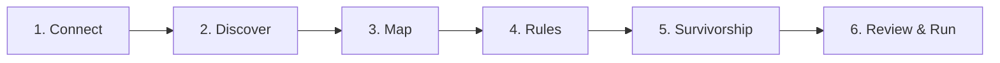

# Web UI Guide

The IDR Web UI is a modern React SPA paired with the FastAPI backend. It enables non-technical and technical users to visually configure, run, monitor, and explore the identity resolution graph.

---

## 🚀 Running the Web UI

### Option 1: Docker Compose (Recommended)
```bash
docker compose up --build
```
- **Web UI**: [http://localhost:3000](http://localhost:3000)
- **FastAPI Backend**: [http://localhost:8000](http://localhost:8000)
- **API Documentation**: [http://localhost:8000/docs](http://localhost:8000/docs)

### Option 2: Local Development
```bash
# Terminal 1: Backend
idr serve --host 0.0.0.0 --port 8000

# Terminal 2: Frontend
cd idr_ui
npm install
npm run dev
```

---

## 🧙‍♂️ 1. Setup Wizard (`/setup`)

The 6-step guided wizard configures and tests your entire identity resolution workflow without manual SQL or YAML editing.



### Step 1: Connect
- Select your target warehouse platform (**DuckDB**, **Snowflake**, **BigQuery**, or **Databricks**).
- Provide connection parameters (e.g., file path, warehouse name, service account key, or Databricks host/token).
- Verifies live connectivity before allowing you to proceed.

### Step 2: Discover
- Select the database schema where your raw tables live.
- View discovered tables and preview schemas and column types.
- Check the source tables you want to include in identity resolution.

### Step 3: Map Identifiers & Attributes
- For each selected table, set the **Entity Key** (unique primary key) and **Watermark Column** (for incremental processing).
- Map identity columns to standardized types (`EMAIL`, `PHONE`, `LOYALTY_ID`, etc.).
- Mark pre-hashed values if already SHA-256 encoded.
- Map golden attributes (e.g. `first_name`, `last_name`, `email`) for profile survivorship.

### Step 4: Matching Rules & Exclusions
- Configure deterministic exact matching rules (`EXACT`) and assign priorities and `max_group_size` limits.
- **Fuzzy Attribute Selector**: Choose a fuzzy similarity template (Jaro-Winkler, Levenshtein, Metaphone), select the target comparison attribute, and the UI automatically substitutes `{col}` into the warehouse-native similarity expression.
- **Identifier Exclusions Editor**: Interactively add exact values or wildcard patterns (`%@noreply.com`) to prevent false-linkage hubs.

### Step 5: Golden Profile Survivorship
- Configure survivorship strategies per attribute:
  - **`RECENCY`**: Latest timestamp wins.
  - **`PRIORITY`**: Rank source tables in priority order (e.g. CRM > POS > Web). Automatically ignores NULL values.
  - **`FREQUENCY`**: Most common value across cluster members wins.

### Step 6: Review, Dry-Run & Execution
- View a unified summary of all configured sources, rules, and survivorship strategies.
- **Accurate Dry-Run Impact Breakdown**: Execute a dry-run to preview proposed entity migrations before committing changes. Displays exact counts for:
  - **Proposed Changes** (`New Entities` + `Moved Clusters`)
  - **Unchanged Entities**
  - **Total Entities**
- Click **Run Pipeline** to execute full resolution.

---

## 🔍 2. Identity Explorer (`/explorer`)

Investigate resolved customer identities, cluster structures, and unified profiles.

- **Unified Search**: Search by email, phone number, loyalty ID, or entity key. Searches across both multi-entity clusters and **singleton entities** (entities with no links).
- **Golden Profile Banner**: Displays the consolidated 360° customer profile directly above the cluster graph.
- **Interactive Graph Visualization**: Visualizes entities as nodes connected by colored edge lines representing the matching rules that linked them.
- **Fuzzy Super-Clusters**: Badges indicate if the cluster belongs to a broader probabilistic Super-Cluster (`super_cluster_id`).
- **Entity Member Table**: Lists every source record with its source system, entity key, and attribute values.

---

## 📊 3. Operational Dashboard (`/dashboard`)

- **High-Level Metrics**: Total Entities Processed, Active Identity Clusters, Edges Formed, and Average Confidence Score.
- **Cluster Size Distribution**: Interactive histogram showing singletons, pairs, small groups (3-5), and large clusters.
- **Rule Performance**: Tracks how many edges each deterministic rule produced.
- **Quality Alerts**: Flags high-cardinality groups or unusual cluster growth.

---

## ⏱️ 4. Pipeline Runs & Stage Drill-Down (`/runs`)

- Complete execution history across `FULL`, `INCR`, and `DRY_RUN` modes.
- **Expandable Stage Telemetry**: Click any run row to view a detailed breakdown of each processing stage (`preflight`, `entity_extraction`, `identifier_extraction`, `attribute_extraction`, `edge_building`, `label_propagation`, `fuzzy_matching`, `output_generation`):
  - Per-stage duration (seconds)
  - Rows affected / produced
  - Label propagation iterations to convergence
  - Operational warnings or error messages
