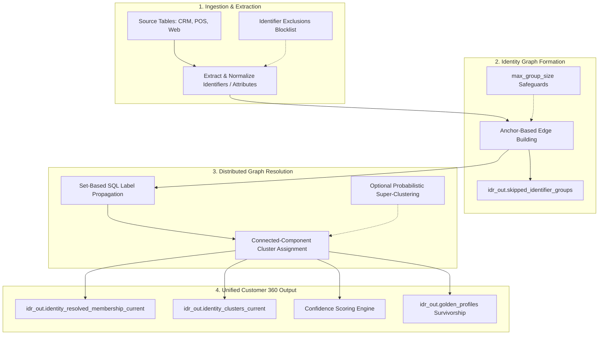

# Architecture

System architecture, design patterns, and cross-platform data flow.

---

## High-Level Design

---

## Schema Layers

### 1. Metadata Layer (`idr_meta`)
- **Source Registry (`source_table`)**: Registered source tables with primary keys, watermark columns, and lookback windows.
- **Rule Definitions (`rule`, `fuzzy_rule`)**: Exact matching rules and probabilistic fuzzy similarity rules.
- **Mappings (`identifier_mapping`, `entity_attribute_mapping`)**: Column-to-identifier and column-to-profile mappings.
- **Survivorship Policies (`survivorship_rule`)**: Declarative resolution strategies (`RECENCY`, `PRIORITY`, `FREQUENCY`).
- **Safety Lists (`identifier_exclusion`)**: Exact and wildcard blocklists for false-linkage prevention.
- **Watermark State (`run_state`)**: Tracks high-watermark timestamps for incremental delta processing.

### 2. Processing & Staging Layer (`idr_work`)
- **Transient State**: Staging tables created and dropped per run (`entities_delta`, `identifiers_all`, `edges_new`, `lp_labels`, `cluster_attributes`).
- **Incremental Efficiency**: In `INCR` mode, only updated source records and their direct neighborhood in the identity graph are extracted into `idr_work`.

### 3. Output Layer (`idr_out`)
- **Resolved Membership (`identity_resolved_membership_current`)**: Maps each source entity to its canonical `resolved_id`.
- **Cluster Registry (`identity_clusters_current`)**: Master list of clusters with size, confidence score, and primary reason.
- **Golden Records (`golden_profiles`)**: Unified customer 360 profile table with resolved survivorship attributes.
- **Active Edges (`identity_edges_current`)**: Direct pairwise edges with evidence rules and observation timestamps.
- **Identifier Registry (`identity_identifiers_current`)**: Active registry enabling fast single-hop candidate expansion in incremental mode.
- **Audit Trails (`run_history`, `stage_metrics`, `config_snapshot`)**: Full telemetry capturing run status, per-stage durations, and configuration hashes.

---

## Cross-Platform Execution Architecture

The core IDR engine is written in pure, dialect-aware SQL generated by [`idr_core`](file:///Users/harihiom/Anil/git/sql-identity-oss/idr_core):
- **DuckDB**: Executes in-process using vectorized execution, ideal for local development, CI/CD, and embedded edge workloads.
- **Snowflake**: Runs in-warehouse via standard SQL or Snowpark sessions, leveraging micro-partition pruning and virtual warehouse scaling.
- **BigQuery**: Serverless parallel processing leveraging DDL/DML, partition pruning, and string similarity functions.
- **Databricks**: Runs natively on Spark SQL / Delta Lake across Serverless SQL Warehouses and Unity Catalog, leveraging Photon acceleration.
