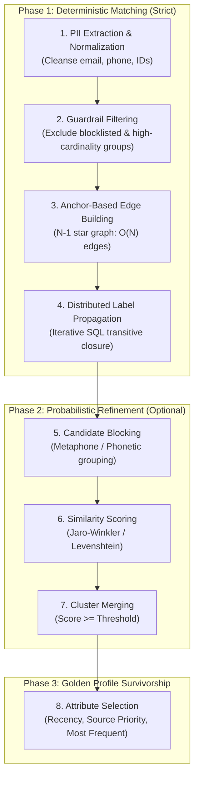

# Matching Algorithm & Graph Resolution

SQL Identity Resolution uses a deterministic-first, graph-native approach to entity linkage. By executing connected component analysis directly within standard SQL engines, it eliminates the need for specialized graph databases or external SaaS tools while maintaining formal mathematical guarantees of partition completeness.

---

## 📐 Algorithm Overview

The resolution engine operates in two principal phases:



---

## 1. Extraction & Normalization

Source tables (e.g. `crm.contacts`, `ecom.orders`, `mobile.users`) contain raw identity signals. During the Extraction Stage:

1. **Mapping Rules**: Each rule in `idr_meta.identifier_mapping` extracts specific columns or expressions.
2. **Normalization Functions**:
   * **Email**: Lowercased, leading/trailing whitespace removed, common aliases stripped.
   * **Phone**: Stripped of non-digit characters (`+`, `-`, `( )`), formatted to E.164 or national 10-digit standard.
   * **Custom Expression**: Supports warehouse-native SQL expressions (e.g., `TRIM(UPPER(loyalty_num))`).
3. **Hashing**: Normalised identifier values are hashed (SHA-256) into `identifier_hash` for uniform indexing and anonymized internal processing.

---

## 2. Guardrails & Cardinality Protections

A common pitfall in identity resolution is "cluster explosion"—a shared identifier (like `support@company.com`, `000-000-0000`, or a shared office phone) linking hundreds of thousands of unrelated individuals into a massive "super-cluster".

`sql-identity-oss` enforces two layers of cardinality protection:

### Exact & Wildcard Blocklists (`idr_meta.identifier_exclusion`)
Before any edges are formed, identifiers are checked against an exclusion registry:

* **Exact match**: Excludes placeholder emails like `test@test.com`, `unknown@gmail.com`.
* **Domain wildcard**: Excludes high-volume corporate email addresses or common generic domains.

### Group Size Capping (`max_group_size`)
Every rule specifies a `max_group_size` (default: 50):

* If an identifier matches $N > \text{max\_group\_size}$ distinct entities, the group is **not linked**.
* Instead, it is routed to `idr_out.skipped_identifier_groups` with the reason `EXCEEDS_MAX_GROUP_SIZE`.
* This ensures that edge generation runtime and memory footprint remain deterministic and sub-linear.

---

## 3. Anchor-Based Edge Building ($O(N)$ vs $O(N^2)$)

Traditional entity resolution connects all pairs within an identifier group, creating a complete graph $K_N$:

$$\text{Edges}_{\text{complete}} = \frac{N(N - 1)}{2} \in O(N^2)$$

For a group of 1,000 records, a complete graph creates 499,500 edges.

Instead, `sql-identity-oss` employs **Anchor-Based Edge Construction**:

1. Within each identifier group, the entity with the lowest lexicographical `entity_key` is designated as the **Anchor**.
2. Directed or undirected edges are formed exclusively between each member and the anchor:

$$\text{Edges}_{\text{anchor}} = N - 1 \in O(N)$$

```
Complete Graph (O(N^2))            Anchor Graph (O(N))
      A --- B                            A (Anchor)
      |  X  |                           / | \
      C --- D                          B  C  D
  (6 edges for 4 nodes)          (3 edges for 4 nodes)
```

Because connected component reachability is transitive ($B \sim A \land C \sim A \implies B \sim C$), the anchor star graph preserves **exact topological connectivity** while drastically reducing edge volume.

---

## 4. SQL-Native Label Propagation

Connected components are resolved using an iterative SQL technique called **Label Propagation**:

1. **Initialization**: Every entity starts with its own `entity_key` as its initial cluster label.
2. **Propagation Step**: In each iteration $k$, every node queries all its immediate neighbors across the edge table and adopts the **minimum label**:
   $$\text{Label}_{v}^{(k+1)} = \min \left( \text{Label}_{v}^{(k)}, \min_{u \in \text{Neighbors}(v)} \text{Label}_{u}^{(k)} \right)$$

3. **Convergence**: The algorithm tracks the number of nodes whose label changed during the iteration.
   * If $\Delta = 0$, the graph has reached a fixed-point equilibrium: all nodes in each connected component share the identical minimum `resolved_id`.
   * Execution terminates automatically or halts when `max_lp_iterations` (default: 30) is reached.
4. **Monotonicity Guarantee**: Labels only ever decrease ($\text{Label}^{(k+1)} \le \text{Label}^{(k)}$). Because the label space is finite and bounded below by the minimum node ID in the component, convergence is mathematically guaranteed.

---

## 5. Probabilistic Refinement (Optional)

When strict deterministic matching is completed, an optional fuzzy matching stage (`--strict=false`) can resolve near-matches:

1. **Blocking**: Candidates are partitioned into narrow blocks using blocking keys (e.g., soundex/metaphone of last name + zip code prefix).
2. **Fuzzy Scoring**: For candidates within the same block, string similarity metrics are computed:
   * Jaro-Winkler for names.
   * Levenshtein / Damerau-Levenshtein for alphanumeric codes.
3. **Merge Evaluation**: If the similarity score exceeds the configured `confidence_threshold` (e.g., 0.85), an edge is materialized and merged into the cluster.

---

## 6. Golden Profile Survivorship

Once clusters (`resolved_id`) are formed, the **Output Stage** consolidates all associated entity records into a single canonical **Golden Customer Profile** using configurable survivorship rules:

| Survivorship Rule | Description | Common Use Case |
| :--- | :--- | :--- |
| `MOST_RECENT` | Selects attribute value from the entity with the latest `updated_at` timestamp | Current residential address, preferred phone |
| `SOURCE_PRIORITY` | Prioritizes authoritative sources (e.g., Billing CRM > Marketing Web Form) | Legal first name, legal last name |
| `MOST_FREQUENT` | Selects the statistical mode across all linked records | Gender, locale, timezone |
| `AGGREGATE_ARRAY` | Aggregates all unique values across records into an array | All historical email addresses, past loyalty IDs |
| `NON_NULL_FALLBACK`| Picks the first non-null value according to source priority | Secondary phone, company name |

All survivorship decisions are written to `idr_out.golden_customer_profiles`, accompanied by the cluster's aggregate confidence score and size metrics.
