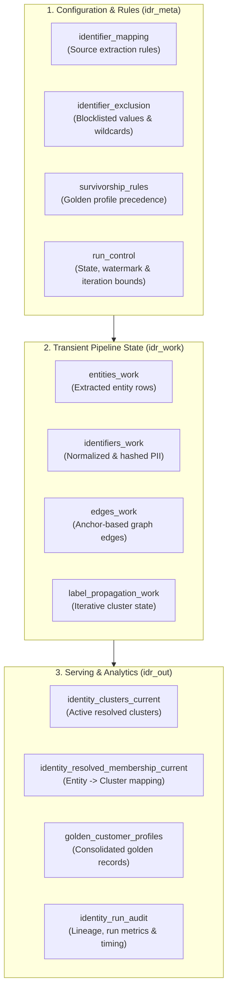
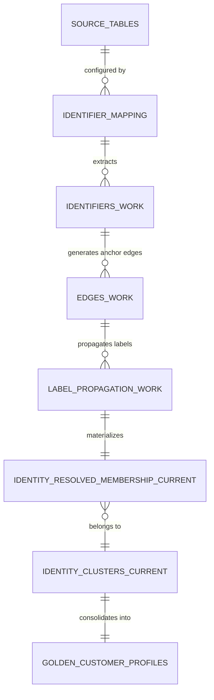

# Data Model & Schema Architecture

SQL Identity Resolution is structured around a three-tier schema architecture designed for high-concurrency warehouses, transactional isolation, and complete auditability.

---

## 🏛️ Three-Tier Schema Architecture

---

## 1. Metadata Schema (`idr_meta`)

Stores rule definitions, source mappings, attribute priority matrices, and pipeline configuration. Changes to this schema take effect on the next pipeline execution.

### Key Tables:
* **`identifier_mapping`**: Defines which columns from source tables contain identifiers (e.g., `EMAIL`, `PHONE`, `ACCOUNT_ID`), the extraction SQL expression, and the `max_group_size` threshold.
* **`identifier_exclusion`**: Contains exact match strings (e.g. `test@example.com`, `0000000000`) and wildcard patterns that must be filtered out before graph construction.
* **`survivorship_rules`**: Configures rule priority (`SOURCE_PRIORITY`, `MOST_RECENT`, `MOST_FREQUENT`) on an attribute-by-attribute basis for constructing golden customer profiles.
* **`run_control`**: Tracks execution parameters, incremental watermarks, and convergence tolerances.

---

## 2. Working Schema (`idr_work`)

Isolated workspace used during pipeline execution. In `INCR` mode, only affected subgraphs and delta entities are processed in this tier, leaving production serving tables untouched until commitment.

### Key Tables:
* **`entities_work`**: Entity keys extracted from source records with primary source timestamps and system origins.
* **`identifiers_work`**: Extracted PII values after case normalization, whitespace trimming, regex cleansing, and cryptographic hashing.
* **`edges_work`**: The materialized graph edges formed between entities. In strict deterministic mode, this table contains star-topology anchor edges connecting entities sharing identical identifiers.
* **`label_propagation_work`**: Working table storing the current cluster label assignments during iterative SQL execution. Tracks label delta counts after each step until $\Delta = 0$.

---

## 3. Output Schema (`idr_out`)

The consumption and serving layer queried by downstream analytics, Reverse ETL, Customer Data Platforms (CDPs), CRM syncs, and BI tools.

### Key Tables:
* **`identity_clusters_current`**: One row per distinct real-world entity / customer cluster:
  * `resolved_id`: Primary key of the resolved entity.
  * `cluster_size`: Number of distinct records grouped into this cluster.
  * `confidence_score`: Weighted confidence calculation (0.00 to 1.00) based on identifier quality.
  * `created_at` / `updated_at`: Cluster lifecycle timestamps.
* **`identity_resolved_membership_current`**: Fast lookup table mapping every source record to its resolved identity:
  * `entity_key`: Unique record key (`source_system:source_pck`).
  * `resolved_id`: Canonical cluster identifier.
  * `is_anchor`: Boolean indicating whether this entity serves as the cluster's anchor.
* **`golden_customer_profiles`**: The unified customer record created by applying survivorship rules across all linked entities:
  * Canonical names, primary email, primary phone, postal address.
  * Unified identifiers array (e.g. all known emails or device tokens associated with this person).
* **`identity_run_audit`**: Granular execution log recording run mode (`FULL` vs `INCR`), stage timings, input row counts, edges materialized, clusters resolved, and convergence iteration counts.
* **`skipped_identifier_groups`**: Audit table documenting identifier values that exceeded `max_group_size` or matched exclusion filters, preserving data quality observability.

---

## 🔗 Entity-Relationship Summary

