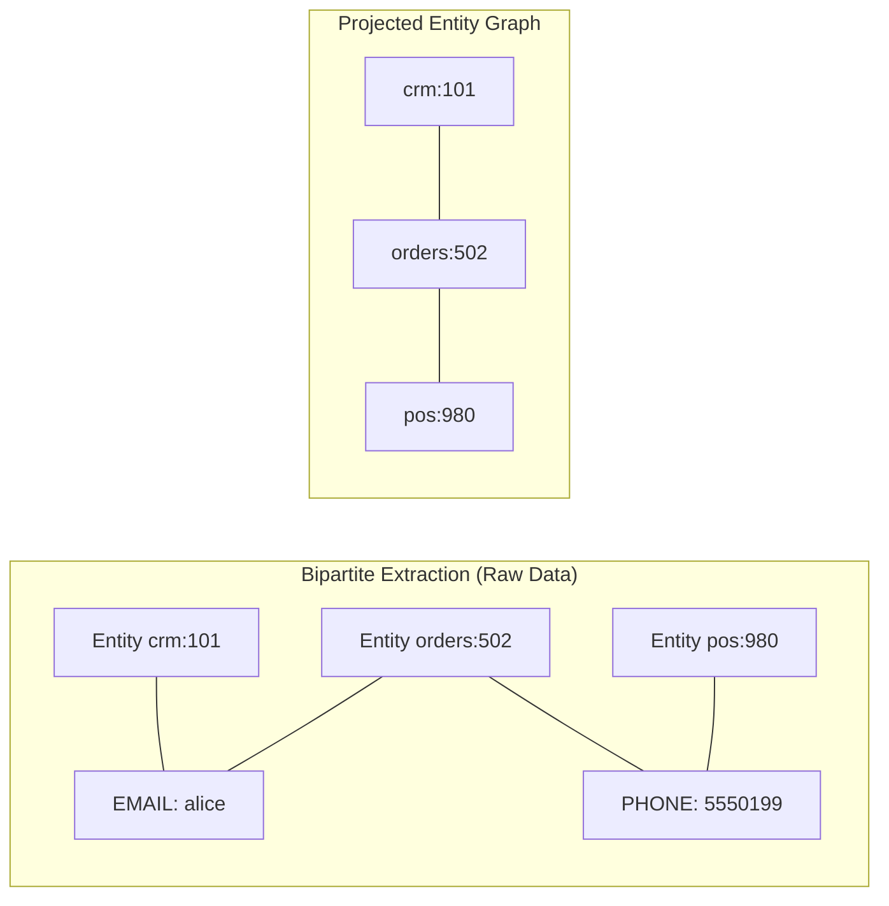
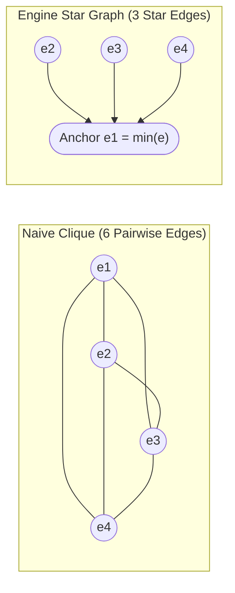
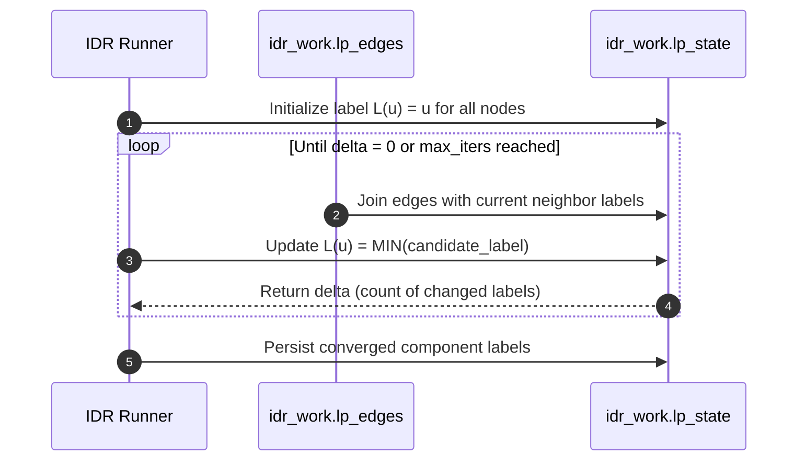
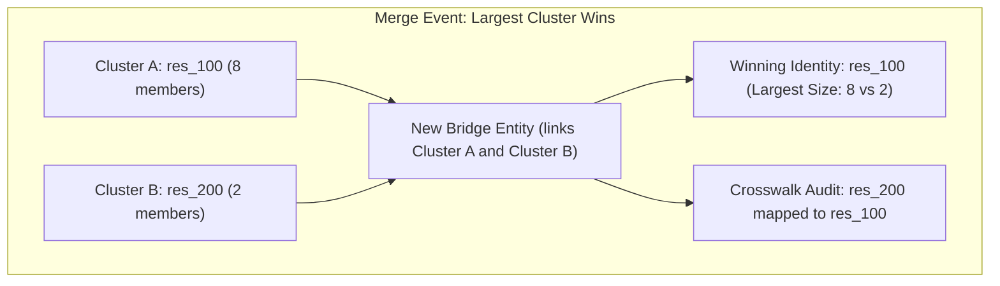
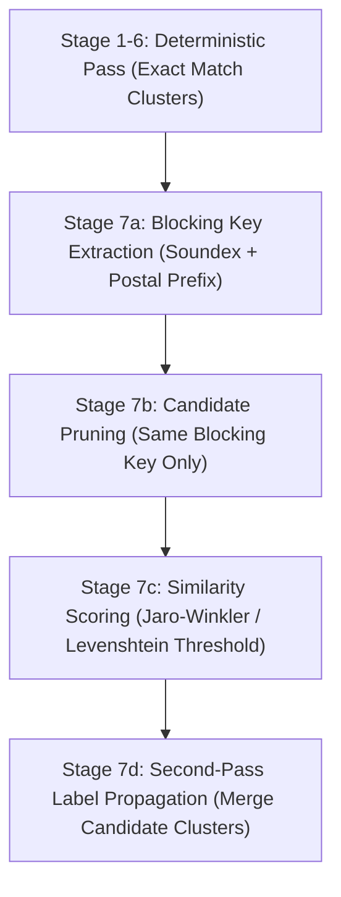

# The Underlying Identity Resolution Algorithm

In enterprise identity resolution, **black-box heuristics and unpredictable recomputation are unacceptable**. Data architects, governance officers, and compliance leads require mathematical proof that:

1. **Resolution is deterministic and transitive**: If record $A$ links to $B$, and $B$ links to $C$, then $A$, $B$, and $C$ resolve to the exact same identity cluster.
2. **Compute scales linearly without query planner crashes**: The graph does not explode into an $\mathcal{O}(N^2)$ pairwise join or crash on recursion depth limits.
3. **Identity IDs are stabilized across time**: A customer's `resolved_id` does not randomly flip tomorrow when a new transaction arrives.
4. **Megaclusters and poison-pills are mathematically bounded**: Shared placeholder values cannot collapse disparate identity clusters.

This document details the underlying graph theory, iterative pure SQL algorithms, and stabilization invariants implemented in `sql-identity-resolution`.

---

## 1. Mathematical Graph Formulation

Identity resolution partitions a set of heterogeneous source records $V = \{e_1, e_2, \dots, e_N\}$ into a set of mutually exclusive, collectively exhaustive equivalence classes (resolved identity clusters):

$$
\mathcal{C} = \{C_1, C_2, \dots, C_K\} \quad \text{such that} \quad \bigcup_{k=1}^K C_k = V \quad \text{and} \quad C_i \cap C_j = \emptyset \; (\forall i \neq j)
$$

### Bipartite to Homogeneous Graph Transformation

Source data consists of entities (rows from tables like CRM, Orders, Web Activity) and extracted, canonicalized identifiers (emails, phone numbers, loyalty cards):

- Let $E$ be the set of entity keys (e.g., `'crm:101'`, `'orders:509'`).
- Let $I$ be the set of canonicalized identifier values (e.g., `'email:alice@example.com'`).
- The relationship forms a **bipartite graph** $G_B = (E \cup I, E_B)$, where edges only exist between entities and their identifiers.

To resolve identities, the engine projects $G_B$ onto the entity domain $E$, producing a homogeneous undirected graph $G = (E, \mathcal{E})$:

$$
(u, v) \in \mathcal{E} \iff \exists \, i \in I \quad \text{such that} \quad (u, i) \in E_B \land (v, i) \in E_B
$$



Any connected component in $G$ constitutes a single resolved identity.

---

## 2. Anchor-Based Star Graph Reduction ($\mathcal{O}(N)$ vs $\mathcal{O}(N^2)$)

### The Clique Edge Explosion Problem
In a naive identity resolution implementation, if an identifier (e.g., a shared household phone or corporate domain) matches $N$ records, generating all pairwise edges creates a complete graph (clique) $K_N$:

$$
\lvert \mathcal{E}_{\text{clique}} \rvert = \frac{N(N - 1)}{2} = \mathcal{O}(N^2)
$$

| Identifier Group Size ($N$) | Pairwise Clique Edges ($\mathcal{O}(N^2)$) | Star Reduction Edges ($\mathcal{O}(N)$) | Storage & Join Reduction |
| :--- | :--- | :--- | :--- |
| **10 records** | 45 edges | **9 edges** | 80.0% reduction |
| **100 records** | 4,950 edges | **99 edges** | 98.0% reduction |
| **1,000 records** | 499,500 edges | **999 edges** | 99.8% reduction |
| **10,000 records** | 49,995,000 edges | **9,999 edges** | **99.98% reduction** |

A single frequent identifier with 10,000 records will generate **50 million rows** in an edge table, causing query planner OOMs, disk spillage, and massive warehouse credit burns.

### The Anchor Reduction Theorem
`sql-identity-resolution` solves this by designating a single deterministic **Anchor Node** for every identifier group:

$$
a(i) = \min \{e \in E \mid (e, i) \in E_B\}
$$

Instead of generating all pairwise combinations, the engine emits only **star edges** connecting each non-anchor node directly to the anchor:

$$
\mathcal{E}_{\text{star}}(i) = \{(e, a(i)) \mid e \in E, (e, i) \in E_B, e \neq a(i)\}
$$



**Theorem (Connected Component Equivalence)**:
> *For any graph $G$, substituting all pairwise cliques with anchor-based star trees preserves exact connected component connectivity while reducing edge complexity from $\mathcal{O}(N^2)$ to $\mathcal{O}(N)$.*

**Proof**:
If $u, v \in \text{group}(i)$, then in the star graph, $u$ is connected to $a(i)$ and $v$ is connected to $a(i)$. Thus, the path $u \leftrightarrow a(i) \leftrightarrow v$ exists. By transitivity, $u$ and $v$ remain in the same connected component. The total edges produced across the entire dataset is bounded by $\sum_{i} (\lvert V_i \rvert - 1) < \sum_i \lvert V_i \rvert \in \mathcal{O}(\lvert E_B \rvert)$. $\blacksquare$

---

## 3. The Anti-Megacluster Guardrail (`max_group_size`)

Even with star graph reduction, a dirty placeholder identifier (e.g., `test@example.com`, `000-000-0000`, `N/A`) can link tens of thousands of unrelated entities together into a **poison-pill mega-cluster**.

To guarantee graph integrity, the engine enforces a strict mathematical circuit breaker during `Stage 5: edge_building`, comparing each identifier's group size $S(i)$ against the effective threshold $M_{\text{allowed}}(i)$:

$$
S(i) = \sum_{e \in E} \mathbb{I}[(e, i) \in E_B]
$$

$$
M_{\text{allowed}}(i) = \min \big( M_{\text{rule}}(i), \, M_{\text{global}} \big)
$$

where $M_{\text{rule}}(i)$ is the rule-specific `max_group_size` and $M_{\text{global}}$ is the global `max_group_size` ceiling.

```sql
WITH identifier_groups AS (
    SELECT
        identifier_type,
        identifier_value_norm,
        COUNT(*) as group_size,
        MIN(entity_key) as anchor_key,
        COALESCE(MAX(max_group_size), 10000) as max_allowed
    FROM idr_work.identifiers_all
    GROUP BY identifier_type, identifier_value_norm
    HAVING COUNT(*) > 1
),
valid_groups AS (
    SELECT * FROM identifier_groups
    WHERE group_size <= max_allowed
),
skipped_groups AS (
    SELECT * FROM identifier_groups
    WHERE group_size > max_allowed
)
```

1. **Edge Filter**: Groups with $S(i) \le M_{\text{allowed}}(i)$ generate valid star edges.
2. **Quarantine Audit**: Groups with $S(i) > M_{\text{allowed}}(i)$ are discarded from edge creation and logged into `idr_out.skipped_identifier_groups` with the reason `'EXCEEDED_MAX_GROUP_SIZE'`.
3. **Zero Contamination**: The rest of the graph resolves normally without being polluted by the discarded identifier.

---

## 4. Pure SQL Connected Components via Iterative Label Propagation

### Why Recursive CTEs Fail in Enterprise Warehouses
Most AI-generated SQL and textbook graph solutions rely on `WITH RECURSIVE`:
- **Snowflake**: Recursion depth is strictly capped (default limit: 100 iterations), throwing: `Recursion limit reached in recursive query`.
- **BigQuery**: Strict memory limits on recursive terms; recursive CTEs cannot be used inside materialized views or dynamic pipelines.
- **Cycle Failures**: Any cycle in the graph ($A \to B \to C \to A$) causes infinite recursion unless tracked with expensive visited path arrays.

### The Min-Label Propagation Algorithm
`sql-identity-resolution` implements a pure set-based, parallelizable **Iterative Min-Label Propagation** algorithm that runs natively in any standard SQL dialect:

1. **Initialization ($k = 0$)**:
    Every entity node $u \in V$ is assigned its own key as its initial cluster label:

    $$
    L_0(u) = u
    $$

2. **Propagation Step ($k \to k + 1$)**:
    In each iteration, every node queries the current labels of all its adjacent neighbors and adopts the minimum label:

    $$
    L_{k+1}(u) = \min \left( L_k(u), \min_{v \in \mathcal{N}(u)} L_k(v) \right)
    $$

    In SQL, this is performed by joining the symmetric edge graph against the current state table:

    ```sql
    CREATE OR REPLACE TABLE idr_work.lp_state_next AS
    WITH neighbor_labels AS (
        SELECT
            e.left_entity_key AS entity_key,
            s.label AS candidate_label
        FROM idr_work.lp_edges e
        JOIN idr_work.lp_state s ON e.right_entity_key = s.entity_key
        UNION ALL
        SELECT entity_key, label FROM idr_work.lp_state
    )
    SELECT
        entity_key,
        MIN(candidate_label) AS label
    FROM neighbor_labels
    GROUP BY entity_key;
    ```

3. **Convergence Metric**:
    The engine evaluates the number of nodes whose label changed during iteration $k$:

    $$
    \Delta_k = \sum_{u \in V} \mathbb{I}[L_{k+1}(u) \neq L_k(u)]
    $$

    - If $\Delta_k = 0$: **Graph convergence reached**. The loop terminates immediately.
    - If $k \ge k_{\max}$: Guardrail safety exit (`max_iters`, default: 30 iterations).

### Proof of Convergence & Complexity
- **Monotonicity**: Because $L_{k+1}(u) = \min(L_k(u), \dots)$, labels are monotonically non-increasing ($L_{k+1}(u) \le L_k(u)$).
- **Lower Bound**: Labels are bounded from below by $\min_{v \in C} (v)$, the minimum entity key in the connected component.
- **Termination**: In a finite graph, a monotonically decreasing sequence bounded from below must reach a fixed point where $L_{k+1}(u) = L_k(u)$ for all $u$.
- **Runtime Complexity**: The number of iterations required is bounded by the **diameter** of the component:

$$
k_{\text{converge}} \le \text{diameter}(C)
$$

Because star graph reduction collapses bipartite clusters into radius-2 stars, real-world customer graphs exhibit very small diameters (typically $2 \le \text{diameter} \le 6$). As a result, the engine **converges in 3 to 7 iterations** across millions of rows.



---

## 5. Deterministic Cross-Run ID Stabilization

### The "Cluster Churn" Problem in Production
In raw connected components, the canonical cluster ID is simply the minimum node key:

$$
\text{id}_{\text{resolved}}(C) = \min_{u \in C} (u)
$$

Consider what happens in production across two consecutive runs:
* **Day 1**: Records `crm:500` and `orders:600` link together. The cluster ID is `crm:500`.
* **Day 2**: A new transaction arrives: `pos:100`. It links to `orders:600`.
* **The Failure**: Naive connected components now computes $\min(\text{crm:500}, \text{orders:600}, \text{pos:100}) = \mathbf{pos:100}$.

**The entire cluster ID flipped from `crm:500` to `pos:100`!**
Downstream implications:
- Data warehouse foreign keys pointing to `crm:500` become orphaned.
- Reverse-ETL syncs to Salesforce/Braze re-create duplicate customer profiles.
- CDC (Change Data Capture) streams flood with millions of artificial update events.

### The 4 Invariants of ID Stabilization
`sql-identity-resolution` implements **Cross-Run `resolved_id` Stabilization** (`GraphStage._stabilize_resolved_ids`):



#### Invariant 1: Monotonic Preservation (Single Cluster Addition)
When new records join an existing cluster, the cluster **retains its established `resolved_id`** from `idr_out.identity_resolved_membership_current`, regardless of whether the incoming record key is lexicographically smaller.

#### Invariant 2: "Largest Cluster Wins" (Merge Resolution)
When a bridge identifier links two or more previously independent clusters $\{C_1, C_2, \dots, C_m\}$, the winning identity is selected by strict deterministic precedence:

$$
C_{\text{winner}} = \operatorname*{argmax}_{C_j} \Big( \lvert C_j \rvert, \; -t_{\text{created}}(C_j), \; -\text{id}_{\text{resolved}}(C_j) \Big)
$$

1. **Size Priority**: The cluster with the largest historical member count $\lvert C_j \rvert$ wins.
2. **Longevity Priority (Tie-Break 1)**: If sizes are equal, the oldest cluster (earliest timestamp $t_{\text{created}}(C_j)$) wins.
3. **Lexicographical Tie-Break (Tie-Break 2)**: Deterministic string comparison on $\text{id}_{\text{resolved}}(C_j)$ guarantees zero non-deterministic randomness.

#### Invariant 3: Split Determinism
When an override (`DO_NOT_LINK` or `ISOLATE`) severs an existing cluster into two pieces, the sub-component that contains the historical anchor preserves the original `resolved_id`. The separated sub-component is designated as a split cluster and receives a fresh canonical ID.

#### Invariant 4: Complete Cryptographic Crosswalk
Every single transition is recorded into `idr_out.resolved_id_crosswalk`:
```sql
CREATE TABLE idr_out.resolved_id_crosswalk (
    run_id VARCHAR,
    old_resolved_id VARCHAR,
    new_resolved_id VARCHAR,
    entity_key VARCHAR,
    change_type VARCHAR,  -- 'MERGE', 'SPLIT', 'NEW'
    changed_at TIMESTAMP
);
```
Downstream consumers can query this crosswalk as an **immutable SCD Type 2 mapping table** to remap legacy foreign keys without data loss.

---

## 6. Deterministic Blocking Key + Fuzzy Matching Bridge

For datasets with phonetic typos, OCR scanning errors, or nickname variations (`"Robert"` vs `"Bob"`), deterministic matching can be augmented with probabilistic fuzzy rules without causing cartesian explosion:



1. **Deterministic Core First**: Stages 1 through 6 resolve exact deterministic links with 100% precision.
2. **Blocking Key Bounding**: Stage 7 extracts blocking keys (e.g. Soundex of surname + first 3 digits of Postal Code). Only entities that match on the blocking key are evaluated.
3. **Similarity Expression**: Compares attributes using SQL similarity functions (e.g., `jaro_winkler_similarity(a.first_name, b.first_name) >= 0.88`).
4. **Hyper-Edge Propagation**: Matching cluster pairs inject bridge edges into a secondary label propagation pass, cleanly unifying probabilistic candidates into the stabilized graph.

---

## 7. Dry Run Impact Simulation Mechanics

When invoked with `--dry-run` or via the **Dry Run Preview** checkbox in the Web UI:

1. **Parallel Execution**: Stages 1 through 7 execute identically, running full canonicalization, star graph reduction, and label propagation in staging schema `idr_work`.
2. **Impact Calculation**: Instead of executing `Stage 8: output_generation` to overwrite `idr_out`, the engine runs `OutputStage.generate_dry_run_output()`, computing an **Impact Delta**:

    ```sql
    SELECT
        COUNT(CASE WHEN m.resolved_id IS NULL THEN 1 END) AS new_entities,
        COUNT(CASE WHEN m.resolved_id IS NOT NULL AND m.resolved_id != w.resolved_id THEN 1 END) AS moved_entities,
        COUNT(CASE WHEN m.resolved_id = w.resolved_id THEN 1 END) AS unchanged_entities
    FROM idr_work.entities_delta e
    JOIN idr_work.resolved_labels w ON e.entity_key = w.entity_key
    LEFT JOIN idr_out.identity_resolved_membership_current m ON e.entity_key = m.entity_key;
    ```

3. **Zero Production Mutation**: The dry run writes zero records to `idr_out`, saves execution telemetry with run prefix `dry_run_*` in `idr_meta.run_history`, and presents the impact summary directly in the UI.

---

## 8. Warehouse Complexity & Performance Summary

| Algorithm Component | Theoretical Complexity | Pure SQL Implementation | Snowflake / BigQuery / Databricks / DuckDB Parity |
| :--- | :--- | :--- | :--- |
| **Edge Generation** | $\mathcal{O}(N)$ | Star graph with `MIN(entity_key)` anchor | Eliminates self-joins; uses single `GROUP BY` + star join |
| **Circuit Breaker** | $\mathcal{O}(1)$ per group | `HAVING COUNT(*) <= max_allowed` | Prevents supernode edge creation before edge table write |
| **Connected Components** | $\mathcal{O}(\text{diameter} \cdot \lvert E \rvert)$ | Iterative `MIN(candidate_label)` join | Zero recursive CTEs; runs in 3–7 set-based batch iterations |
| **ID Stabilization** | $\mathcal{O}(K \log K)$ | Window rank `ROW_NUMBER() OVER (PARTITION BY ... ORDER BY size DESC)` | Deterministic tie-breaking; zero UUID drift on batch updates |
| **Incremental Delta** | $\mathcal{O}(\Delta N)$ | Watermark preservation + candidate expansion | Short-circuits 0-delta runs without full graph recompute |
