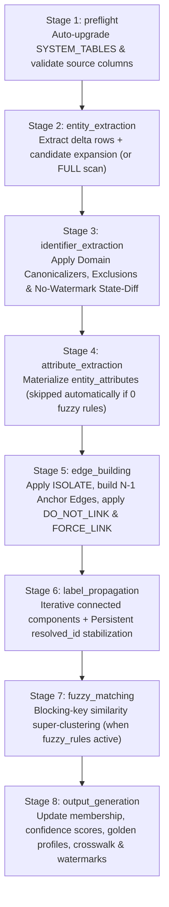

# Core Concepts & 8-Stage Pipeline Architecture

This guide explains the foundational data model and the 8-stage execution engine that powers `sql-identity-resolution`.

---

## 1. Core Building Blocks

Every source table registered in `idr_meta.source_table` defines four distinct concepts:

| Concept | Role in the Pipeline | Example |
| :--- | :--- | :--- |
| **`entity_key`** | Globally unique composite primary key (`<table_id>:<raw_key>`) identifying a single row from a source table as a graph node. | `'crm:10042'`, `'orders:98112'` |
| **`watermark_column`** | Timestamp or monotonically increasing column used in `INCR` runs to extract new/updated rows since `last_watermark_value`. Optional (tables without a watermark use state-diffing). | `updated_at`, `order_date` |
| **Identifiers** (`idr_meta.source_identifier`) | Match keys extracted, canonicalized, and filtered against exclusions to build **deterministic graph edges** between entities. | `EMAIL`, `PHONE`, `LOYALTY_ID`, `CUSTOMER_ID` |
| **Attributes** (`idr_meta.entity_attribute_mapping`) | Descriptive profile columns used after graph resolution to build the **Golden Profile** (`idr_out.golden_profile_current`) via survivorship rules (and optionally evaluated by fuzzy blocking rules). | `first_name`, `last_name`, `lifetime_value`, `country_code` |

> [!IMPORTANT]
> **Identifiers vs. Attributes**:
> - **Identifiers** decide *which records belong to the same person* (Graph Connectivity).
> - **Attributes** decide *which profile values win for that person* (Golden Record Survivorship).

---

## 2. The 8-Stage Execution Pipeline

Whether triggered via `idr run`, the Web UI (`POST /api/setup/run`), MCP (`run_pipeline`), or `IDRRunner.run()`, the engine executes 8 deterministic stages in sequence and emits real-time telemetry via `progress_callback`:

### Stage-by-Stage Breakdown

#### Stage 1: `preflight` (`PreflightStage`)
- Automatically upgrades existing warehouse schemas by checking `SYSTEM_TABLES` (`_ensure_schema_upgrades`) and creating any newly introduced tables (`idr_meta.identity_override`, `idr_meta.privacy_audit_log`, `idr_out.resolved_id_crosswalk`, etc.) without requiring a manual reset.
- Verifies that `idr_meta.source_table` and `idr_meta.rule` are populated and validates that every configured `entity_key_expr`, `watermark_column`, identifier expression, and attribute expression exists in the physical source tables.

#### Stage 2: `entity_extraction` (`ExtractionStage.extract_entities`)
- **`FULL` Mode**: Extracts all entities (`WHERE 1=1`) from active source tables into `idr_work.entities_delta`.
- **`INCR` Mode**:
  - For tables **with** a `watermark_column`: filters `WHERE <watermark_column> > <last_watermark_value>` (minus optional `watermark_lookback_minutes`).
  - For tables **without** a `watermark_column`: scans all rows (`WHERE 1=1`) and marks the table for Stage 3 identifier state-diffing so in-place `UPDATE`s to existing rows are caught while unchanged rows are pruned before candidate expansion.

#### Stage 3: `identifier_extraction` (`ExtractionStage.extract_identifiers`)
- Applies the rule's configured **Domain Canonicalizer** (`EMAIL_STANDARD`, `EMAIL_STRIP_PLUS`, `PHONE_DIGITS`, `PHONE_US_10`, `ALPHANUMERIC_UPPER`, `LOWERCASE`, `UPPERCASE`, `EXACT`/`NONE`, or custom inline SQL `{val}`) to produce `identifier_value_norm`.
- Excludes poison-pill identifiers matching `idr_meta.identifier_exclusion` (supporting both specific `identifier_type` and wildcard `ANY` / `*` rules, with case-insensitive `EXACT` and `LIKE` matching).
- **No-Watermark State-Diffing (`INCR` mode)**:
  - Compares extracted `(entity_key, identifier_type, identifier_value_norm)` tuples from no-watermark tables against `idr_out.identity_identifiers_current`.
  - Any entity whose identifier set is 100% identical to the previous run is pruned from `idr_work.entities_delta` and `idr_work.identifiers_extracted`.
- **Candidate Expansion (`INCR` mode)**:
  - Pulls in historical entities from `idr_out.identity_identifiers_current` and `idr_out.identity_resolved_membership_current` that share an identifier or cluster with the newly changed delta entities (`watermark_value = NULL`), ensuring entire impacted connected components are re-evaluated accurately.
- **Zero-Delta Short-Circuit**:
  - If `0` newly changed entities remain after watermark filtering and state-diffing, `IDRRunner` short-circuits Stages 4–8 and completes in seconds.

#### Stage 4: `attribute_extraction` (`ExtractionStage.extract_attributes`)
- When **active `fuzzy_rules` exist**, extracts mapped attributes for delta entities into `idr_work.entity_attributes`.
- **Zero-Fuzzy Optimization**: When `0` active fuzzy rules are configured, Stage 4 skips materializing `idr_work.entity_attributes` entirely (saving tens of millions of intermediate row writes on large datasets) because Stage 8's `ProfileBuilder` queries source tables directly.

#### Stage 5: `edge_building` (`GraphStage.build_edges`)
1. **Pre-Edge Overrides (`ISOLATE`)**: Removes any entity listed as `ISOLATE` in `idr_meta.identity_override` from `idr_work.identifiers_all` so it never forms edges.
2. **Anchor-Based Star Edges ($N-1$ Edges)**:
   - Groups `idr_work.identifiers_all` by `(identifier_type, identifier_value_norm)`.
   - Filters out groups where `COUNT(*) > max_group_size` (logging oversized groups to `idr_out.skipped_identifier_groups`).
   - Connects every member of a valid group to `MIN(entity_key)` (`anchor_key`), producing $N-1$ edges instead of $\frac{N(N-1)}{2}$ edges.
3. **Post-Edge Overrides (`DO_NOT_LINK` & `FORCE_LINK`)**:
   - `DO_NOT_LINK`: Deletes direct edges between `(entity_key_a, entity_key_b)` and detaches `MAX(entity_key_a, entity_key_b)` from any shared identifier anchor group containing `MIN(entity_key_a, entity_key_b)`.
   - `FORCE_LINK`: Injects an explicit `MANUAL_OVERRIDE` edge between `(entity_key_a, entity_key_b)` and ensures both entities are registered in `idr_work.entities_delta`.

#### Stage 6: `label_propagation` (`GraphStage.label_propagation`)
- Builds undirected edges (`lp_edges`) over active connected nodes and iteratively propagates `MIN(candidate_label)` across neighbors until `changes == 0` (or `max_iters` is reached).
- Re-attaches singleton entities (entities with zero incident edges) with `label = entity_key`.
- Executes **Persistent `resolved_id` Stabilization** (`_stabilize_resolved_ids`) so existing cluster IDs are preserved across runs.

#### Stage 7: `fuzzy_matching` (`GraphStage.fuzzy_matching`)
- Evaluates active rules in `idr_meta.fuzzy_rule` over deterministic clusters using blocking keys (`blocking_key_expr`) and similarity expressions (`score_expr >= threshold`), merging matching clusters via a second label propagation pass.

#### Stage 8: `output_generation` (`OutputStage.generate_outputs`)
- Updates `idr_out.identity_resolved_membership_current` and `idr_out.identity_identifiers_current`.
- Records any `old_resolved_id -> new_resolved_id` transitions into `idr_out.resolved_id_crosswalk`.
- Computes cluster-level confidence scores (`confidence_score`, `edge_diversity`, `match_density`, `primary_reason`) in `idr_out.identity_clusters_current`.
- Builds `idr_out.golden_profile_current` via `ProfileBuilder` using configured survivorship strategies (`PRIORITY`, `RECENCY`, `FREQUENCY`).
- Updates `idr_meta.run_state` watermarks using `WHERE watermark_value IS NOT NULL` so candidate-expanded historical rows (`watermark_value = NULL`) never overwrite `last_watermark_value`.

---

## 3. Persistent `resolved_id` Stabilization & Crosswalk

In naive graph pipelines, `resolved_id` is simply `MIN(entity_key)` of each connected component. If `crm:500` and `orders:600` initially form cluster `crm:500`, and a new record `ads:100` arrives tomorrow, `MIN(entity_key)` would flip the entire cluster's ID from `crm:500` to `ads:100`—breaking downstream BI dashboards, reverse ETL syncs, and feature stores.

`sql-identity-resolution` solves this with **Cross-Run `resolved_id` Stabilization** (`GraphStage._stabilize_resolved_ids`):

1. **New Entities Joining an Existing Cluster**:
   - When new entities connect to an existing cluster from `idr_out.identity_resolved_membership_current`, the cluster **retains its existing `resolved_id`** regardless of whether the new entity key is lexicographically smaller.
2. **Two Existing Clusters Merging ("Largest Cluster Wins")**:
   - When a new bridge identifier merges two previously separate clusters ($C_1$ and $C_2$), the **largest previous cluster's `resolved_id` wins** (`ORDER BY prev_size DESC, prev_created_at ASC, prev_resolved_id ASC`).
3. **Cluster Splits**:
   - If an override (`DO_NOT_LINK` or `ISOLATE`) splits an existing cluster into two components, only one component may claim the historical `resolved_id` (preferring the component containing the anchor entity key), while the split-off component receives a fresh canonical ID.
4. **Audit Crosswalk (`idr_out.resolved_id_crosswalk`)**:
   - Every time an entity's `old_resolved_id` transitions to a `new_resolved_id` (e.g., the smaller cluster in a merge adopting the larger cluster's `resolved_id`), Stage 8 writes an immutable mapping row to `idr_out.resolved_id_crosswalk(run_id, old_resolved_id, new_resolved_id, entity_key, change_type, changed_at)`.

