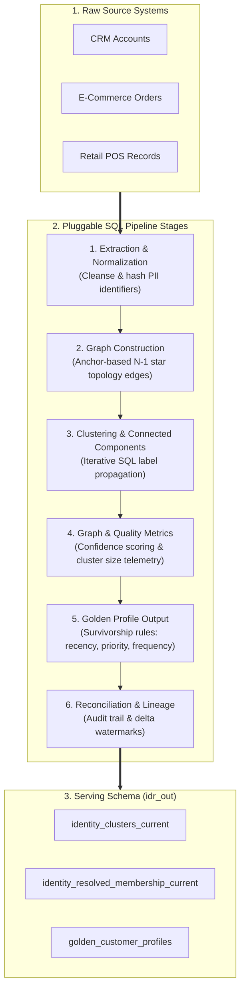

---
hide:
  - navigation
  - toc
---

<div class="idr-hero">
  <div class="idr-hero-badge">
    ⚡ Warehouse-Native Identity Resolution v0.6.1 • Apache 2.0
  </div>
  <h1 class="idr-hero-title">
    Deterministic Customer 360.<br/>
    <span class="idr-gradient-text">Zero Data Movement.</span>
  </h1>
  <p class="idr-hero-subtitle">
    Unify fragmented customer records natively inside DuckDB, Snowflake, BigQuery, and Databricks.
    Pure SQL connected components, deterministic confidence scoring, and 17 FastMCP agent tools.
  </p>
  <div class="idr-hero-cta">
    <a href="03-quickstart/" class="idr-btn-primary">Get Started in 60s →</a>
    <a href="https://github.com/anilkulkarni87/sql-identity-oss" class="idr-btn-secondary" target="_blank">
      <svg width="18" height="18" viewBox="0 0 24 24" fill="currentColor"><path d="M12 0c-6.626 0-12 5.373-12 12 0 5.302 3.438 9.8 8.207 11.387.599.111.793-.261.793-.577v-2.234c-3.338.726-4.033-1.416-4.033-1.416-.546-1.387-1.333-1.756-1.333-1.756-1.089-.745.083-.729.083-.729 1.205.084 1.839 1.237 1.839 1.237 1.07 1.834 2.807 1.304 3.492.997.107-.775.418-1.305.762-1.604-2.665-.305-5.467-1.334-5.467-5.931 0-1.311.469-2.381 1.236-3.221-.124-.303-.535-1.524.117-3.176 0 0 1.008-.322 3.301 1.23.957-.266 1.983-.399 3.003-.404 1.02.005 2.047.138 3.006.404 2.291-1.552 3.297-1.23 3.297-1.23.653 1.653.242 2.874.118 3.176.77.84 1.235 1.911 1.235 3.221 0 4.609-2.807 5.624-5.479 5.921.43.372.823 1.102.823 2.222v3.293c0 .319.192.694.801.576 4.765-1.589 8.199-6.086 8.199-11.386 0-6.627-5.373-12-12-12z"/></svg>
      GitHub (Apache 2.0)
    </a>
  </div>
  <p align="center" style="margin: 0; display: flex; justify-content: center; align-items: center; gap: 0.5rem; flex-wrap: wrap;">
    <a href="https://github.com/anilkulkarni87/sql-identity-oss/actions/workflows/test.yml"></a>
    
    <a href="https://github.com/anilkulkarni87/sql-identity-oss/blob/main/LICENSE"></a>
    
  </p>
</div>

<div class="idr-stats-grid">
  <div class="idr-stat-card">
    <div class="idr-stat-number">0</div>
    <div class="idr-stat-label">Data Movement / Egress</div>
  </div>
  <div class="idr-stat-card">
    <div class="idr-stat-number">50,000+</div>
    <div class="idr-stat-label">Entities / Sec Scale</div>
  </div>
  <div class="idr-stat-card">
    <div class="idr-stat-number">4</div>
    <div class="idr-stat-label">Cloud Warehouses Supported</div>
  </div>
  <div class="idr-stat-card">
    <div class="idr-stat-number">17</div>
    <div class="idr-stat-label">FastMCP Agent Tools</div>
  </div>
</div>

## 🧩 Architectural Highlights

<div class="idr-cards-grid">
  <div class="idr-card">
    <div class="idr-card-icon">🛡️</div>
    <h3>Zero Data Egress</h3>
    <p>All data stays entirely inside your warehouse security perimeter (DuckDB, Snowflake, BigQuery, Databricks). Fully compliant with HIPAA, GDPR, and CCPA.</p>
  </div>
  <div class="idr-card">
    <div class="idr-card-icon">🎯</div>
    <h3>Deterministic & Auditable</h3>
    <p>Every edge, cluster, and golden attribute is backed by explicit match rules and Spanning Tree Connectivity scoring. No probabilistic black-box hallucinations.</p>
  </div>
  <div class="idr-card">
    <div class="idr-card-icon">⚡</div>
    <h3>Anchor-Based Graph Building</h3>
    <p>Avoids Cartesian join blowouts on common identifiers by connecting groups via star-topology anchor edges (O(N) complexity instead of O(N²)).</p>
  </div>
  <div class="idr-card">
    <div class="idr-card-icon">🔄</div>
    <h3>Incremental Delta Upsert</h3>
    <p>Local Subgraph Stitching isolates only impacted clusters during incremental runs, updating 1.5M clusters in seconds without full historical scans.</p>
  </div>
  <div class="idr-card">
    <div class="idr-card-icon">🔑</div>
    <h3>Zero-Retype Credentials</h3>
    <p>Auto-detects active credentials from <code>~/.databrickscfg</code>, <code>~/.snowflake/connections.toml</code>, <code>~/.dbt/profiles.yml</code>, and Google Cloud ADC with 1-click connect.</p>
  </div>
  <div class="idr-card">
    <div class="idr-card-icon">🤖</div>
    <h3>AI Agent Ready (MCP)</h3>
    <p>Includes 17 FastMCP tools allowing Cursor, Claude Desktop, and Antigravity to autonomously profile schemas, simulate rule impact, and resolve Customer 360 records.</p>
  </div>
</div>

---

## 📊 Comparison: In-Warehouse IDR vs. Alternatives

| Capability | `sql-identity-oss` | SaaS CDPs (Segment / Hightouch) | Legacy MDM (Tamr / Informatica) | Ad-Hoc SQL JOINs |
| :--- | :--- | :--- | :--- | :--- |
| **Data Movement** | **Zero (In-Warehouse)** | High (Data synced to vendor cloud) | High (Data extracted to external clusters) | Zero |
| **Cost / License** | **Free / Apache 2.0 (OSS)** | \$30k–\$150k+/yr | \$100k+/yr enterprise licenses | High engineering hours |
| **Graph Resolution** | **Multi-hop Label Propagation** | Limited / Flat rules | ML black box | Fails on >2 hops (Join blowouts) |
| **Auditability** | **100% Explainable SQL & Lineage** | Closed vendor black box | Statistical probabilities | Custom scripts |
| **Survivorship** | **Dynamic (Recency, Priority, Mode)** | Basic / First seen | Complex custom rules | Manual CASE/COALESCE |
| **dbt & SQL Native** | **Full dbt package (`dbt_idr`)** | No (Proprietary UI/APIs) | No (Custom pipelines) | Manual SQL |
| **AI Agent Readiness** | **17 FastMCP Tools included** | Closed API | Closed API | None |

---

## ⚡ 60-Second Quickstart

Try identity resolution immediately using your local DuckDB engine—no cloud credentials or setup required:

```bash
# 1. Install IDR with DuckDB, API, and MCP extras
pip install "sql-identity-resolution[duckdb,api,mcp]"

# 2. Run the automated quickstart
idr quickstart
```

This single command synthesizes 10,000 multi-source customer records across Web, Store, Mobile, and Call Center, injects cross-channel identifier overlaps (Email, Phone, Loyalty ID), provisions schemas (`idr_meta`, `idr_work`, `idr_out`), applies matching rules, and materializes golden customer profiles with full survivorship logic.

---

## 🏗️ Supported Warehouses & Execution Matrix

| Warehouse | Connection Mode | Incremental Merge | Distributed Scale | Production Ready |
| :--- | :--- | :--- | :--- | :--- |
| **DuckDB** | Local file / In-memory | `INSERT INTO` (Upsert) | Single-node (up to 50M rows) | Yes (Dev / Edge) |
| **Snowflake** | Snowpark / DB-API connector | `MERGE INTO` | Multi-cluster warehouse (100M+) | Yes (Enterprise) |
| **BigQuery** | Cloud SDK / Service Account | `MERGE` | Serverless slot autoscaling | Yes (Enterprise) |
| **Databricks** | Spark Connect / Unity Catalog | `MERGE INTO` (Delta) | Photon / Multi-worker clusters | Yes (Enterprise) |

---

## 🧩 Architectural Pipeline



---

## 🛠️ Multiple Ways to Operate

=== "CLI"
    ```bash
    # Run full identity resolution
    idr run --config idr_config.yaml --mode FULL

    # Run incremental resolution on new data
    idr run --config idr_config.yaml --mode INCR

    # Inspect graph health and clusters
    idr metrics --output json
    ```

=== "FastAPI & REST"
    ```bash
    # Start REST API with Swagger docs and Prometheus metrics
    idr-api --host 0.0.0.0 --port 8000
    # Visit http://localhost:8000/docs
    ```

=== "Model Context Protocol (MCP)"
    ```bash
    # Start MCP server for Claude Desktop / Cursor / Antigravity
    idr-mcp
    ```

=== "React Web UI"
    ```bash
    # Launch interactive visual dashboard
    cd idr_ui && npm run dev
    # Access cluster exploration, graph metrics, and pipeline controls
    ```

=== "dbt Integration"
    ```yaml
    # packages.yml
    packages:
      - package: anilkulkarni87/dbt_idr
        version: 0.6.1
    ```

---

## 📚 Documentation Navigation

* **[Overview](01-overview.md)**: Deep dive into the architecture, design principles, and comparison with legacy CDPs.
* **[Quickstart](03-quickstart.md)**: Step-by-step hands-on guide from zero to resolved customer profiles.
* **[Installation](02-installation.md)**: Pip extras, virtual environments, Docker Compose, and production containers.
* **[Platform Adapters](06-platforms.md)**: Detailed configuration guides for Snowflake, BigQuery, Databricks, and DuckDB.
* **[Matching Algorithm](19-matching-algorithm.md)**: Mathematical underpinnings of deterministic matching and label propagation.
* **[Schema Reference](08-schema.md)**: Comprehensive DDL reference for `idr_meta`, `idr_work`, and `idr_out`.
* **[MCP Server](11-mcp.md)**: Connect LLMs and autonomous agents to your identity resolution pipeline.
* **[Scale Testing](13-scale-testing.md)**: Benchmarks and test recipes for datasets from 100K to 10M+ records.
* **[Troubleshooting](14-troubleshooting.md)**: Diagnostic recipes for graph explosion, slow label propagation, and warehouse timeouts.

---

## 📄 License & Community

SQL Identity Resolution is open-source software licensed under the [Apache License, Version 2.0](https://github.com/anilkulkarni87/sql-identity-oss/blob/main/LICENSE). Contributions, bug reports, and feature requests are welcome on [GitHub](https://github.com/anilkulkarni87/sql-identity-oss)!
