# SQL Identity Resolution (`sql-identity-oss`)

<p align="center">
  <strong>Warehouse-Native, Deterministic Identity Resolution & Customer 360 for Modern Data Platforms</strong>
</p>

<p align="center">
  <a href="https://github.com/anilkulkarni87/sql-identity-oss/actions/workflows/test.yml"></a>
  <a href="https://pypi.org/project/sql-identity-resolution/"></a>
  <a href="https://github.com/anilkulkarni87/sql-identity-oss/blob/main/LICENSE"></a>
  <a href="https://anilkulkarni87.github.io/sql-identity-oss/"></a>
</p>

---

## 🚀 Why SQL Identity Resolution?

Unifying fragmented customer records across CRM, point-of-sale, e-commerce, mobile applications, and support tickets has historically required either **costly SaaS identity vendors** (sending sensitive PII outside your cloud boundary) or **opaque black-box ML tools**.

**`sql-identity-oss`** resolves identity **entirely inside your data warehouse**:

* **Zero Data Egress**: All data stays inside your security perimeter (DuckDB, Snowflake, BigQuery, Databricks). Fully compliant with HIPAA, GDPR, and CCPA.
* **Deterministic & Fully Auditable**: Every edge, link, and cluster decision is documented with confidence scores, rule IDs, and full lineage. No probabilistic hallucinations.
* **Anchor-Based Edge Building ($O(N)$ vs $O(N^2)$)**: Avoids Cartesian blowouts on common identifiers by connecting groups via star-topology anchor edges.
* **Pure SQL Connected Components**: Distributed Label Propagation executes natively in SQL without requiring graph database infrastructure (Neo4j, AWS Neptune).
* **AI-Ready with Model Context Protocol (MCP)**: Native MCP server exposing 14 tools for AI agents (Cursor, Claude Desktop, Antigravity) to inspect, configure, and operate identity pipelines.
* **Rich Developer Ecosystem**: First-class Python CLI (`idr`), FastAPI REST service, Prometheus metrics, interactive React Web UI, and dbt package (`dbt_idr`).

---

## ⚡ 60-Second Quickstart

Try identity resolution immediately using your local DuckDB engine—no cloud credentials or setup required:

```bash
# 1. Install IDR with DuckDB, API, and MCP extras
pip install "sql-identity-resolution[duckdb,api,mcp]"

# 2. Run the automated quickstart
idr quickstart
```

This single command:
1. Synthesizes 10,000 multi-source customer records across Web, Store, Mobile, and Call Center.
2. Injects cross-channel identifier overlaps (Email, Phone, Loyalty ID).
3. Provisions schemas (`idr_meta`, `idr_work`, `idr_out`) and applies matching rules.
4. Executes the 6-stage identity resolution pipeline.
5. Materializes cluster memberships and golden customer profiles with survivorship logic.

---

## 🏗️ Supported Warehouses & Execution Matrix

| Warehouse | Connection Mode | Incremental Merge | Distributed Scale | Production Ready |
| :--- | :--- | :--- | :--- | :--- |
| **DuckDB** | Local file / In-memory | `INSERT INTO` | Single-node (up to 50M rows) | Yes (Dev / Edge) |
| **Snowflake** | Snowpark / DB-API connector | `MERGE INTO` | Multi-cluster warehouse (100M+) | Yes (Enterprise) |
| **BigQuery** | Cloud SDK / Service Account | `MERGE` | Serverless slot autoscaling | Yes (Enterprise) |
| **Databricks** | Spark Connect / Unity Catalog | `MERGE INTO` (Delta) | Photon / Multi-worker clusters | Yes (Enterprise) |

---

## 🧩 Architectural Pipeline

```mermaid
flowchart LR
    subgraph Sources["Raw Sources"]
        CRM["CRM Accounts"]
        Web["E-Commerce"]
        POS["Retail POS"]
    end

    subgraph Stages["6 Pluggable Pipeline Stages"]
        S1["1. Extraction<br/>(Normalize PII)"]
        S2["2. Graph Building<br/>(Anchor-based Edges)"]
        S3["3. Clustering<br/>(Label Propagation)"]
        S4["4. Metrics<br/>(Graph & Quality)"]
        S5["5. Output<br/>(Golden Profiles)"]
        S6["6. Reconciliation<br/>(History & Lineage)"]
    end

    subgraph Targets["Target Schema (idr_out)"]
        Clusters["identity_clusters_current"]
        Membership["identity_resolved_membership_current"]
        Profiles["golden_customer_profiles"]
    end

    Sources --> S1
    S1 --> S2 --> S3 --> S4 --> S5 --> S6
    S6 --> Targets
```



---

## 🛠️ Multiple Ways to Operate

=== "CLI"
    ```bash
    # Run full identity resolution
    idr run --config idr_config.yaml --mode FULL

    # Run incremental resolution on new data
    idr run --config idr_config.yaml --mode INCR

    # Inspect graph health and clusters
    idr metrics --output json
    ```

=== "FastAPI & REST"
    ```bash
    # Start REST API with Swagger docs and Prometheus metrics
    idr-api --host 0.0.0.0 --port 8000
    # Visit http://localhost:8000/docs
    ```

=== "Model Context Protocol (MCP)"
    ```bash
    # Start MCP server for Claude Desktop / Cursor / Antigravity
    idr-mcp
    ```

=== "React Web UI"
    ```bash
    # Launch interactive visual dashboard
    cd idr_ui && npm run dev
    # Access cluster exploration, graph metrics, and pipeline controls
    ```

=== "dbt Integration"
    ```yaml
    # packages.yml
    packages:
      - package: anilkulkarni87/dbt_idr
        version: 0.5.1
    ```

---

## 📚 Documentation Navigation

* **[Overview](01-overview.md)**: Deep dive into the architecture, design principles, and comparison with legacy CDPs.
* **[Quickstart](03-quickstart.md)**: Step-by-step hands-on guide from zero to resolved customer profiles.
* **[Installation](02-installation.md)**: Pip extras, virtual environments, Docker Compose, and production containers.
* **[Platform Adapters](06-platforms.md)**: Detailed configuration guides for Snowflake, BigQuery, Databricks, and DuckDB.
* **[Matching Algorithm](19-matching-algorithm.md)**: Mathematical underpinnings of deterministic matching and label propagation.
* **[Schema Reference](08-schema.md)**: Comprehensive DDL reference for `idr_meta`, `idr_work`, and `idr_out`.
* **[MCP Server](11-mcp.md)**: Connect LLMs and autonomous agents to your identity resolution pipeline.
* **[Scale Testing](13-scale-testing.md)**: Benchmarks and test recipes for datasets from 100K to 10M+ records.
* **[Troubleshooting](14-troubleshooting.md)**: Diagnostic recipes for graph explosion, slow label propagation, and warehouse timeouts.

---

## 📄 License & Community

SQL Identity Resolution is open-source software licensed under the [Apache License, Version 2.0](https://github.com/anilkulkarni87/sql-identity-oss/blob/main/LICENSE). Contributions, bug reports, and feature requests are welcome on [GitHub](https://github.com/anilkulkarni87/sql-identity-oss)!
