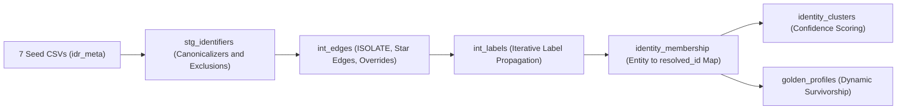

# Interfaces: CLI, Web UI, FastAPI, MCP Server & dbt

`sql-identity-resolution` provides five first-class interfaces that share the exact same underlying metadata model and graph resolution semantics.

---

## 1. Unified CLI Reference (`idr`)

| Command | Description | Example |
| :--- | :--- | :--- |
| `idr quickstart` | Generate synthetic retail data and run a complete local DuckDB resolution pipeline. | `idr quickstart --rows 10000 --output demo.duckdb` |
| `idr bootstrap` | Auto-profile warehouse tables and synthesize production YAML configuration (`--apply` loads to warehouse). | `idr bootstrap --platform bigquery --schema ecommerce_synth --output idr_config.yaml --apply` |
| `idr doctor` | Run production readiness diagnostics (connectivity, permissions, schemas, watermarks, guardrails). | `idr doctor --platform bigquery --project my-project` |
| `idr evaluate` | Compute Pairwise Precision/Recall/F1 against ground truth or build stratified audit samples (`idr_out.evaluation_sample`). | `idr evaluate --platform bigquery --project my-project` |
| `idr init` | Initialize `idr_meta`, `idr_work`, and `idr_out` schemas and tables (`--reset` recreates them). | `idr init --platform duckdb --db demo.duckdb` |
| `idr apply-config` / `idr config apply` | Compile and load a declarative YAML manifest into `idr_meta.*` and archive a snapshot in `idr_out.config_snapshot`. | `idr config apply --db demo.duckdb --file config.yaml` |
| `idr config history` | List saved configuration snapshots (`config_hash`, timestamp, source/rule/survivorship counts). | `idr config history --db demo.duckdb` |
| `idr config rollback` | Restore `idr_meta.*` to the previous saved snapshot (or a specific `--hash` prefix). | `idr config rollback --db demo.duckdb [--hash a1b2c3d4]` |
| `idr run` | Execute the 8-stage resolution pipeline (`--mode FULL\|INCR`, `--dry-run`, `--critique`, `--config <yaml>`, `--strict`). Pass `--dry-run --critique` for ephemeral evaluation + zero-PII AI Graph Critique (Beta). | `idr run --db demo.duckdb --mode FULL --config candidate.yaml --dry-run --critique` |
| `idr ai generate-config` | Zero-PII AI Rule & Config Generator (Beta) with live 5-step progress (`--grain`, `--event-policy`, `--system-of-record`, `--goal`). | `idr ai generate-config --db demo.duckdb --grain individual --event-policy bridge -o idr_config.yaml` |
| `idr privacy forget` | Execute GDPR/CCPA right-to-be-forgotten erasure by `--entity-key` or `--identifier-value`. | `idr privacy forget --db demo.duckdb --entity-key crm:101` |
| `idr ui` / `idr serve` | Launch the FastAPI backend and bundled React Web UI (`http://127.0.0.1:8000`). | `idr ui --db demo.duckdb --port 8000` |
| `idr mcp` | Launch the FastMCP server for Claude Desktop, Cursor, and AI coding agents. | `idr mcp --db demo.duckdb` |
| `idr dbt export` | Export YAML config or live warehouse `idr_meta.*` tables into the 7 `dbt_idr` seed CSVs. | `idr dbt export --file config.yaml --output-dir dbt_idr/seeds` |
| `idr status` | Print recent pipeline runs and summary statistics from `idr_out.run_history`. | `idr status --db demo.duckdb` |
| `idr inspect` | Inspect an entity key or cluster (`resolved_id`), its members, edges, and golden profile. | `idr inspect --db demo.duckdb --cluster crm:1` |

---

## 2. Interactive React Web UI (`idr ui`)

Launch the full-stack UI and API with a single command (serves the production bundle from `idr_api/static` on port `8000` and opens your browser automatically):

```bash
# Auto-discovers local DuckDB, BigQuery (gcloud ADC), Snowflake, and Databricks profiles
idr ui

# Or specify a local DuckDB database / custom port
idr ui --db demo.duckdb --port 8000
```

> **Local UI Development (`idr_ui/`)**: When modifying React/TypeScript files in `idr_ui/src/`, run `cd idr_ui && npm run dev` for hot-reloading at `http://localhost:3000` (which proxies `/api` to `http://127.0.0.1:8000`), and run `cd idr_ui && npm run build && rm -rf ../idr_api/static/* && cp -R dist/* ../idr_api/static/` so `idr ui` on `:8000` serves the latest production assets.

### Design System & Global Workbench Controls
- **Crisp Daylight & Dark Engineering Themes**: Defaults to **Crisp Daylight Engineering** (`IBM Plex Sans` + `JetBrains Mono` with `tabular-nums` and 1px structural borders) with a persistent **Daylight / Dark appearance toggle** in the sidebar footer.
- **Top-Bar `Run Pipeline` Slide-Over Drawer**: On configured workspaces, clicking **`Run Pipeline`** in the top header opens a focused slide-over execution drawer (`INCR` vs `FULL`, `Dry Run`, guardrails, and live stage telemetry) without routing back through the setup wizard.
- **Global `AI Copilot (⌘K)` Drawer**: Accessible from the top bar or via `⌘K` / `Ctrl+K` on any screen for natural-language graph Q&A, largest-cluster forensics, anomaly triage (`+ Exclude Hub`), and performance trend diagnostics.

### Authentication Modes
- **Local Development Mode (Default for `idr ui`)**:
  - When bound to a loopback address (`127.0.0.1` / `localhost`), `idr ui` automatically enables `IDR_ALLOW_INSECURE_DEV_AUTH=true`, and the React SPA (`IDRAuthProvider.tsx`) activates local dev auth on loopback hosts when `VITE_AUTH_AUTHORITY` is not set.
- **Enterprise OIDC / JWT Mode (Production)**:
  - Set `IDR_AUTH_ISSUER`, `IDR_AUTH_AUDIENCE`, `VITE_AUTH_AUTHORITY`, and `VITE_AUTH_CLIENT_ID` (e.g., Keycloak, Okta, Auth0, Azure AD) to enforce Bearer JWT validation across all API routes.

### Identity Studio (`/setup`)
- **Connect Data Warehouse**: Clean 2-column connection workspace with auto-discovered local credentials (**1-Click Connect** for `~/.dbt/profiles.yml`, `~/.databrickscfg`, `gcloud` ADC, and local DuckDB files) and segmented auth selectors:
  - **Snowflake**: Switch cleanly between `Password` and `RSA Key-Pair (JWT)` (`private_key_path` / inline PEM + optional passphrase).
  - **Databricks**: Switch cleanly between `Personal Access Token (PAT)` and `OAuth M2M (Client Secret)`.
- **Persistent Sticky Studio Header**: Quick actions for `Switch Warehouse`, `History` (view & restore `idr_out.config_snapshot` versions), `Discard` unsaved draft changes, `Save Config`, and `JSON` import/export.
- **4 Persistent Studio Tabs**:
  1. **Sources & Mappings (`1. Sources & Mappings`)**: Merged table discovery and mapping workspace with a multi-schema **Add / Manage Source Tables** browser, optional **AI Goal** bar with inline policy controls (**Grain**: `Strict Individual` / `Household` / `Account`, **Event Tables**: `Bridge Only` / `Include` / `Exclude`, **System of Record**), **1-Click `AI Suggest Config`** with a live 5-step SSE progress stepper (`Profile Tables → Joins & Anomalies → Map Sources → Rules & Survivorship → SQL Verification`, PK→FK & domain-agnostic join discovery, 4-way table-role classification, full-table pushdown stats & heavy-hitter placeholder exclusion discovery), and **inline attribute aliasing** with one-click homonym collision fixes (e.g., `orders.status → orders_status`).
  2. **Matching Rules (`2. Matching Rules`)**: Organized into 4 focused sub-tabs:
     - **Match Rules**: Deterministic rules with all 9 **Domain Canonicalizers**, probabilistic fuzzy rules, and an inline **AI Rule Generator** bar (with live 5-step SSE progress).
     - **Multi-Lens Views**: Policy-scoped identity views (`strict_person`, `household`, `b2b_account`) with `include_types`, `exclude_types`, `source_filter`, and `max_group_size`.
     - **Blocklist Exclusions**: **Default Poison-Pill Exclusions (`use_default_exclusions`)** (33 patterns including GDPR `redacted` / `erased_%@%` / `%@anonymized.%`) plus custom `EXACT`/`LIKE` or `ANY` wildcard exclusions.
     - **Stewardship Overrides**: Manual `FORCE_LINK`, `DO_NOT_LINK`, and `ISOLATE` entity-pair rules.
  3. **Survivorship (`3. Survivorship`)**: Configure `PRIORITY`, `RECENCY`, `FREQUENCY`, and domain-specific winners per Golden Profile attribute.
  4. **Run & Verify (`4. Run & Verify`)**:
     - **Non-Saving Draft Dry Run**: Click **Start Dry Run** to test unsaved edits ephemerally (`idr_meta.*` is backed up and automatically restored—showing `Draft Previewed — Saved Config Untouched`) without mutating saved metadata or production `idr_out` tables.
     - **5-Card Delta Summary & Closed-Loop AI Graph Critique**: Inspect `New Entities`, `Moved Entities`, `Edges Delta`, `Clusters Delta`, and `Unchanged Entities`, or click **Analyze & Refine with AI** (`POST /api/ai/critique-dry-run`) to get a zero-PII **Graph Health Scorecard** (`Healthy` / `Needs Tuning` / `Over-Merged Risk`) with one-click **Apply to Draft** patches (remove zero-edge rules, exclude high-singleton event tables, enable default exclusions, tighten fuzzy thresholds) and **Re-Run Dry Run →**.
     - **Live Stage Execution Progress**: Real-time progress bar (`GET /api/setup/run/progress`) with domain-specific stage units (`sources verified`, `entities`, `identifiers`, `Skipped (exact only)` / `attributes`, `edges`, `clusters`, `entities analyzed`, `profiles`).

### Cluster Explorer & Stewardship Workbench (`/explorer`)
- **7:5 Split Workbench**: Interactive Cytoscape graph canvas on the left (7 columns, solid deterministic vs dashed fuzzy edges, docked non-overlapping toolbar, interactive source filter pills, and automatic collapsing of high-volume source tables `>12` entities into expandable hub nodes like `Clickstream ×109` via the `Grouped (>12)` toggle) paired with a 3-tab Inspector on the right (5 columns: **Golden Record** key-value table | **Edges** provenance | **Entities** grouped by source table).
- **Multi-Lens Selector & Cross-Lens Diff Modal**: Switch between the Primary Graph and any configured Identity Lens, or click **Compare Lenses** to inspect cluster boundary migrations (`Merged in Lens B Only` vs `Merged in Lens A Only`).
- **AI Cluster Forensics**: Click **Explain with AI** or ask custom questions about why a cluster merged and potential over-merge risks.
- **Collapsible Crosswalk Lineage**: Compact 1-line transition summary bar (`N transitions · M entities moved`, `MERGED`/`SPLIT` badges, and origin source breakdown pills) that expands into a scrollable 5-column lineage table.
- **Inline Stewardship & GDPR Forget**: 1-click identifier exclusion, 2-click entity `Unlink` (`DO_NOT_LINK`) / `Isolate` (`ISOLATE`), and two-step **GDPR / CCPA Right to be Forgotten** cluster purge with SHA-256 suppression.

---

## 3. FastAPI REST Endpoints (`idr_api`)

| Method & Path | Description |
| :--- | :--- |
| `POST /api/connect` | Connect to DuckDB, Snowflake, BigQuery, or Databricks and initialize session lease. |
| `GET /api/setup/config` | Reconstruct the active declarative configuration from `idr_meta.*` (`sql_to_config`) or latest snapshot. |
| `GET /api/setup/config/history` | List versioned configuration snapshots from `idr_out.config_snapshot` for draft loading or rollback. |
| `POST /api/setup/config/save` | Validate and apply configuration (`config_to_sql`) to `idr_meta.*` and archive a snapshot. |
| `POST /api/setup/run` | Execute the 8-stage `IDRRunner` in a background worker thread and return `RunSummary` (accepts optional `config` payload with `dry_run: true` for ephemeral non-saving evaluation). |
| `GET /api/setup/run/progress` | Poll non-blocking in-memory stage progress (`stage_index`, `stage`, `iteration`, `changes`, `elapsed_seconds`). |
| `POST /api/ai/suggest-config/stream` | Stream live 5-step SSE progress events (`profiling`, `discovery`, `pass_a`, `pass_b`, `validation`) followed by the validated zero-PII AI configuration plan. |
| `POST /api/ai/critique-dry-run` | Analyze zero-PII Dry Run graph telemetry (`lp_labels`, `edges_new`, `skipped_identifier_groups`) and return a Graph Health Scorecard with one-click draft refinement patches. |
| `GET /api/clusters/{id}` | Retrieve cluster members, connecting edges, confidence breakdown, and Golden Profile. |
| `GET /api/explorer/overrides` | List active manual stewardship overrides from `idr_meta.identity_override`. |
| `POST /api/explorer/overrides` | Create a `FORCE_LINK`, `DO_NOT_LINK`, or `ISOLATE` override. |
| `DELETE /api/explorer/overrides/{id}` | Deactivate a manual stewardship override. |
| `POST /api/explorer/forget` | Execute GDPR/CCPA erasure via `PrivacyManager` and return the audit receipt. |
| `GET /metrics` | Prometheus metrics endpoint (`idr_entities_processed`, `idr_clusters_created`, `idr_run_duration_seconds`). |

---

## 4. FastMCP Server for AI Agents (`idr mcp`)

Expose your identity graph and configuration tools to **Antigravity**, **Codex**, **Cursor**, **Claude Desktop**, and **VS Code Copilot**. The FastMCP server enables AI agents to query the identity graph, resolve Customer 360 profiles, explain edges, and simulate rules directly against your warehouse.

### Client Configuration Guides

=== "Antigravity"

    Configure stdio transport in `.agents/mcp_config.json` (workspace) or `~/.gemini/config/mcp_config.json` (global):

    ```json
    {
      "mcpServers": {
        "idr-graph": {
          "command": "idr",
          "args": ["mcp"],
          "env": {
            "IDR_PLATFORM": "bigquery",
            "IDR_PROJECT": "your-gcp-project",
            "IDR_PII_ACCESS": "masked"
          }
        }
      }
    }
    ```

=== "OpenAI Codex"

    Add to `~/.codex/config.json` or `~/.codex/mcp.json`:

    ```json
    {
      "mcpServers": {
        "idr-graph": {
          "command": "idr",
          "args": ["mcp"],
          "env": {
            "IDR_PLATFORM": "duckdb",
            "IDR_DATABASE": "/absolute/path/to/demo.duckdb"
          }
        }
      }
    }
    ```

=== "Cursor"

    Add to `.cursor/mcp.json` in your project root:

    ```json
    {
      "mcpServers": {
        "idr-graph": {
          "command": "idr",
          "args": ["mcp"],
          "env": {
            "IDR_PLATFORM": "duckdb",
            "IDR_DATABASE": "/absolute/path/to/demo.duckdb"
          }
        }
      }
    }
    ```

=== "Claude Desktop"

    Add to `~/.config/claude/claude_desktop_config.json`:

    ```json
    {
      "mcpServers": {
        "idr-graph": {
          "command": "idr",
          "args": ["mcp"],
          "env": {
            "IDR_PLATFORM": "duckdb",
            "IDR_DATABASE": "/absolute/path/to/demo.duckdb"
          }
        }
      }
    }
    ```

=== "VS Code (Copilot)"

    Add to `.vscode/settings.json`:

    ```json
    {
      "mcp": {
        "servers": {
          "idr-graph": {
            "command": "idr",
            "args": ["mcp"],
            "env": {
              "IDR_PLATFORM": "duckdb",
              "IDR_DATABASE": "/absolute/path/to/demo.duckdb"
            }
          }
        }
      }
    }
    ```

!!! tip "Virtual Environments"
    If `idr` is installed inside a virtual environment (e.g. `.venv`), set `"command"` to `/path/to/venv/bin/python` and `"args"` to `["-m", "idr_mcp.server"]`.

### Remote MCP Transport (`streamable-http`) & Agent Self-Discovery
- **Remote HTTP Endpoint**: FastAPI mounts FastMCP at `POST /mcp` (`streamable-http`), sharing the active warehouse `ConnectionManager` and OAuth/workspace SSO—no local `stdio` wrapper required for remote agents.
- **Standalone HTTP**: Run `IDR_MCP_TRANSPORT=streamable-http idr-mcp` to expose Streamable HTTP directly.
- **Self-Documenting Specs**: Exposes MCP Resources (`idr://spec/config-schema`, `idr://spec/cli-commands`, `idr://spec/canonicalizers`), the `model_config_from_tables` prompt, [`llms.txt`](llms.txt), and [`skills/sql-identity-resolution/SKILL.md`](https://github.com/anilkulkarni87/sql-identity-oss/blob/main/skills/sql-identity-resolution/SKILL.md).

### Exposed MCP Tools (23 Agentic Tools)
- `resolve_customer_360(identifier_type, identifier_value)` — Single-call Customer 360 context grounding (canonical identity, golden profile, all linked accounts & identifiers).
- `discover_and_suggest_rules()` — Autonomous table profiling, PII detection, and suggested IDR YAML configuration.
- `simulate_rule_impact(...)` — Non-destructive dry-run simulation of candidate matching rules with supernode risk alerting.
- `get_triage_queue(max_confidence=0.45, limit=20)` & `submit_evaluation_label(sample_id, label, rationale)` — Closed-loop LLM-as-a-judge quality triage over low-confidence clusters and `idr_out.evaluation_sample`.
- `explain_cluster(resolved_id, max_entities=50, max_edges=50)` & `get_cluster(...)` — Bounded, context-window-safe cluster inspection with `total_entities`, `total_edges`, `distinct_identifier_types`, and `truncated` metadata.
- `forget_customer_identity(...)` & `manage_identity_override(...)` — Two-step **preview-then-confirm** guardrails (`dry_run=True` returns a 5-minute `confirmation_token` + `blast_radius_summary` required for destructive execution).
- `explain_edge(entity_a, entity_b)` — View evidence for why two records matched (direct or transitive).
- `search_identifier(identifier_type, value)` & `get_golden_profile(resolved_id)` — Find clusters and fetch surviving attributes.
- `list_skipped_groups()`, `get_metrics_summary()`, `get_system_status()`, `dry_run_pipeline()`, & `run_history()` — Guardrail inspection, lifecycle state, and execution telemetry.

### Event Webhooks for Autonomous Ops (Headless)
Set `IDR_WEBHOOK_URL` (and optional `IDR_WEBHOOK_SECRET` for `X-IDR-Signature: sha256=...` HMAC verification) to receive non-blocking JSON events on:
- `run.completed` / `run.failed`
- `guardrail.skipped_groups_spike` (configurable via `IDR_WEBHOOK_SKIPPED_THRESHOLD`, default `5`)
- `crosswalk.cluster_changes`
- `privacy.erasure_completed` (zero-PII receipt)

### PII Safety Controls
By default, all sensitive PII (emails, phone numbers, exact match values) is masked in tool outputs (`jo***hn@example.com`). To grant the agent full unmasked values, explicitly pass `"IDR_PII_ACCESS": "full"` in the server `"env"`.

---

## 5. `dbt_idr` Package Integration

For teams that orchestrate transformations strictly through **dbt Core** or **dbt Cloud**, [`dbt_idr`](https://github.com/anilkulkarni87/sql-identity-oss/tree/main/dbt_idr) provides a pure-Jinja SQL implementation compatible with `dbt-duckdb`, `dbt-snowflake`, `dbt-bigquery`, and `dbt-databricks`.

> **When to use `dbt_idr` vs. `idr run` (`idr_core`)**: `dbt_idr` is designed as a **batch/full-refresh dbt starter** (supporting anchor-star edges, `max_group_size`, `FORCE_LINK`/`DO_NOT_LINK`/`ISOLATE` overrides, confidence scoring, and `golden_profiles`). Unlike ID-stitching-only dbt packages, it includes survivorship and stewardship overrides out of the box—and shares the same metadata schema so you can graduate to `idr run` (`idr_core`) whenever you need **incremental cluster splits**, **cross-run `resolved_id` stabilization**, **pre-write blast-radius gates**, or **fuzzy matching**.

### Exporting Config to dbt Seeds (`idr dbt export`)

You can design your rules in YAML or the Web UI and export all **7 standard `dbt_idr` seed CSVs** in one command:

```bash
# Export from YAML file
idr dbt export --file examples/config_retail.yaml --output-dir dbt_idr/seeds

# Or export directly from a live warehouse's idr_meta.* tables
idr dbt export --platform duckdb --db demo.duckdb --output-dir dbt_idr/seeds
```

### Generated Seed Files (`dbt_idr/seeds/`)
1. `idr_sources.csv` — Source table coordinates, `entity_key_column`, and `watermark_column`.
2. `idr_identifier_mappings.csv` — Source identifier columns (`EMAIL`, `PHONE`, `LOYALTY`, etc.).
3. `idr_attribute_mappings.csv` — Source attribute mappings for survivorship.
4. `idr_rules.csv` — Match rules, `canonicalize` strategy (`EMAIL_STANDARD`, `EMAIL_STRIP_PLUS`, `PHONE_US_10`, inline SQL `{val}`, etc.), and `max_group_size`.
5. `idr_exclusions.csv` — Default and custom exclusions (including `ANY` wildcard patterns).
6. `idr_survivorship_rules.csv` — `PRIORITY`, `RECENCY`, and `FREQUENCY` survivorship rules.
7. `idr_overrides.csv` — Manual stewardship overrides (`FORCE_LINK`, `DO_NOT_LINK`, `ISOLATE`).

### Running `dbt_idr`

```bash
cd dbt_idr
dbt seed
dbt run
dbt test
```

### `dbt_idr` Model DAG



