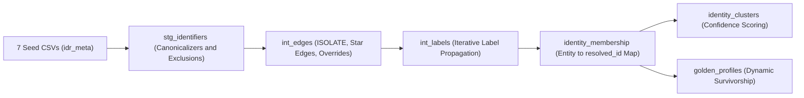

# Interfaces: CLI, Web UI, FastAPI, MCP Server & dbt

`sql-identity-resolution` provides five first-class interfaces that share the exact same underlying metadata model and graph resolution semantics.

---

## 1. Unified CLI Reference (`idr`)

| Command | Description | Example |
| :--- | :--- | :--- |
| `idr quickstart` | Generate synthetic retail data and run a complete local DuckDB resolution pipeline. | `idr quickstart --rows 10000 --output demo.duckdb` |
| `idr bootstrap` | Auto-profile warehouse tables and synthesize production YAML configuration (`--apply` loads to warehouse). | `idr bootstrap --platform bigquery --schema ecommerce_synth --output idr_config.yaml --apply` |
| `idr doctor` | Run production readiness diagnostics (connectivity, permissions, schemas, watermarks, guardrails). | `idr doctor --platform bigquery --project my-project` |
| `idr evaluate` | Compute Pairwise Precision/Recall/F1 against ground truth or build stratified audit samples (`idr_out.evaluation_sample`). | `idr evaluate --platform bigquery --project my-project` |
| `idr init` | Initialize `idr_meta`, `idr_work`, and `idr_out` schemas and tables (`--reset` recreates them). | `idr init --platform duckdb --db demo.duckdb` |
| `idr apply-config` | Compile and load a declarative YAML manifest into `idr_meta.*` tables. | `idr apply-config --db demo.duckdb --config config.yaml` |
| `idr run` | Execute the 8-stage resolution pipeline (`--mode FULL` or `--mode INCR`, `--dry-run`, `--strict`). | `idr run --db demo.duckdb --mode INCR --max-iters 30` |
| `idr privacy forget` | Execute GDPR/CCPA right-to-be-forgotten erasure by `--entity-key` or `--identifier-value`. | `idr privacy forget --db demo.duckdb --entity-key crm:101` |
| `idr ui` / `idr serve` | Launch the FastAPI backend and bundled React Web UI (`http://127.0.0.1:8000`). | `idr ui --db demo.duckdb --port 8000` |
| `idr mcp` | Launch the FastMCP server for Claude Desktop, Cursor, and AI coding agents. | `idr mcp --db demo.duckdb` |
| `idr dbt export` | Export YAML config or live warehouse `idr_meta.*` tables into the 7 `dbt_idr` seed CSVs. | `idr dbt export --file config.yaml --output-dir dbt_idr/seeds` |
| `idr status` | Print recent pipeline runs and summary statistics from `idr_out.run_history`. | `idr status --db demo.duckdb` |
| `idr inspect` | Inspect an entity key or cluster (`resolved_id`), its members, edges, and golden profile. | `idr inspect --db demo.duckdb --cluster crm:1` |

---

## 2. Interactive React Web UI (`idr ui`)

Launch the full-stack UI and API with a single command:

```bash
idr ui --db demo.duckdb
```

### Authentication Modes
- **Local Development Mode (Default for `idr ui`)**:
  - When bound to a loopback address (`127.0.0.1` / `localhost`), `idr ui` automatically enables `IDR_ALLOW_INSECURE_DEV_AUTH=true`, and the React SPA (`IDRAuthProvider.tsx`) activates local dev auth on loopback hosts when `VITE_AUTH_AUTHORITY` is not set.
- **Enterprise OIDC / JWT Mode (Production)**:
  - Set `IDR_AUTH_ISSUER`, `IDR_AUTH_AUDIENCE`, `VITE_AUTH_AUTHORITY`, and `VITE_AUTH_CLIENT_ID` (e.g., Keycloak, Okta, Auth0, Azure AD) to enforce Bearer JWT validation across all API routes.

### 6-Step Setup Wizard (`/setup`)
1. **Connect (`StepConnect`)**: Auto-discovers local DuckDB files, `gcloud` ADC projects, `~/.snowflake/connections.toml`, and `~/.databrickscfg` profiles, or accepts custom warehouse credentials.
2. **Discover (`StepDiscover`)**: Scans schemas and tables in your warehouse with fuzzy search and row count previews.
3. **Map (`StepMap`)**: Auto-detects `entity_key`, `watermark_column` (`updated_at`, `modified_at`, `order_date`, `event_ts`, etc.), identifiers, and attributes per source table.
4. **Rules & Exclusions (`StepRules`)**:
   - Configure deterministic rules with all 9 **Domain Canonicalizers** (`EMAIL_STANDARD`, `EMAIL_STRIP_PLUS`, `PHONE_DIGITS`, `PHONE_US_10`, `ALPHANUMERIC_UPPER`, `LOWERCASE`, `UPPERCASE`, `EXACT`/`NONE`) or a **Custom SQL (`{val}`)** expression input.
   - Toggle **Default Poison-Pill Exclusions (`use_default_exclusions`)** and add custom `EXACT`/`LIKE` or `ANY` wildcard exclusions.
5. **Survivorship (`StepSurvivorship`)**: Configure `PRIORITY`, `RECENCY`, or `FREQUENCY` winners per profile attribute.
6. **Review & Run (`StepReview`)**:
   - **Above-the-Fold Action Bar & Run Configuration**: Choose `Incremental (Faster)` or `Full Refresh`, `Max Iterations`, `Strict Mode`, or `Dry Run` and click **Save Config** or **Run Pipeline** without scrolling.
   - **Collapsible Summary Cards**: Click `Source Tables`, `Rules & Guardrails`, `Survivorship`, or `Raw JSON` to inspect configuration details in bounded drawers.
   - **Live 8-Stage Execution Progress**: Real-time progress bar (`GET /api/setup/run/progress`), elapsed timer, active stage indicator, and live Label Propagation iteration & label-change counter.

### Cluster Explorer & Stewardship (`/explorer`)
- Search by identifier value, `entity_key`, or `resolved_id` to inspect cluster graphs, confidence breakdowns, and Golden Profiles.
- **Stewardship Overrides Modal**: Create or delete `FORCE_LINK`, `DO_NOT_LINK`, and `ISOLATE` overrides directly from the UI.
- **GDPR Forget Entity Modal**: Purge an entity across all IDR tables with a single audited action.

---

## 3. FastAPI REST Endpoints (`idr_api`)

| Method & Path | Description |
| :--- | :--- |
| `POST /api/connect` | Connect to DuckDB, Snowflake, BigQuery, or Databricks and initialize session lease. |
| `GET /api/setup/AutoConfig` | Reconstruct the full declarative configuration from `idr_meta.*` tables (`sql_to_config`). |
| `POST /api/setup/save` | Validate and apply configuration (`config_to_sql`) to `idr_meta.*`. |
| `POST /api/setup/run` | Execute the 8-stage `IDRRunner` in a background worker thread and return `RunSummary`. |
| `GET /api/setup/run/progress` | Poll non-blocking in-memory stage progress (`stage_index`, `stage`, `iteration`, `changes`, `elapsed_seconds`). |
| `GET /api/clusters/{id}` | Retrieve cluster members, connecting edges, confidence breakdown, and Golden Profile. |
| `GET /api/explorer/overrides` | List active manual stewardship overrides from `idr_meta.identity_override`. |
| `POST /api/explorer/overrides` | Create a `FORCE_LINK`, `DO_NOT_LINK`, or `ISOLATE` override. |
| `DELETE /api/explorer/overrides/{id}` | Deactivate a manual stewardship override. |
| `POST /api/explorer/forget` | Execute GDPR/CCPA erasure via `PrivacyManager` and return the audit receipt. |
| `GET /metrics` | Prometheus metrics endpoint (`idr_entities_processed`, `idr_clusters_created`, `idr_run_duration_seconds`). |

---

## 4. FastMCP Server for AI Agents (`idr mcp`)

Expose your identity graph and configuration tools to **Antigravity**, **Codex**, **Cursor**, **Claude Desktop**, and **VS Code Copilot**. The FastMCP server enables AI agents to query the identity graph, resolve Customer 360 profiles, explain edges, and simulate rules directly against your warehouse.

### Client Configuration Guides

=== "Antigravity"

    Configure stdio transport in `.agents/mcp_config.json` (workspace) or `~/.gemini/config/mcp_config.json` (global):

    ```json
    {
      "mcpServers": {
        "idr-graph": {
          "command": "idr",
          "args": ["mcp"],
          "env": {
            "IDR_PLATFORM": "bigquery",
            "IDR_PROJECT": "your-gcp-project",
            "IDR_PII_ACCESS": "masked"
          }
        }
      }
    }
    ```

=== "OpenAI Codex"

    Add to `~/.codex/config.json` or `~/.codex/mcp.json`:

    ```json
    {
      "mcpServers": {
        "idr-graph": {
          "command": "idr",
          "args": ["mcp"],
          "env": {
            "IDR_PLATFORM": "duckdb",
            "IDR_DATABASE": "/absolute/path/to/demo.duckdb"
          }
        }
      }
    }
    ```

=== "Cursor"

    Add to `.cursor/mcp.json` in your project root:

    ```json
    {
      "mcpServers": {
        "idr-graph": {
          "command": "idr",
          "args": ["mcp"],
          "env": {
            "IDR_PLATFORM": "duckdb",
            "IDR_DATABASE": "/absolute/path/to/demo.duckdb"
          }
        }
      }
    }
    ```

=== "Claude Desktop"

    Add to `~/.config/claude/claude_desktop_config.json`:

    ```json
    {
      "mcpServers": {
        "idr-graph": {
          "command": "idr",
          "args": ["mcp"],
          "env": {
            "IDR_PLATFORM": "duckdb",
            "IDR_DATABASE": "/absolute/path/to/demo.duckdb"
          }
        }
      }
    }
    ```

=== "VS Code (Copilot)"

    Add to `.vscode/settings.json`:

    ```json
    {
      "mcp": {
        "servers": {
          "idr-graph": {
            "command": "idr",
            "args": ["mcp"],
            "env": {
              "IDR_PLATFORM": "duckdb",
              "IDR_DATABASE": "/absolute/path/to/demo.duckdb"
            }
          }
        }
      }
    }
    ```

!!! tip "Virtual Environments"
    If `idr` is installed inside a virtual environment (e.g. `.venv`), set `"command"` to `/path/to/venv/bin/python` and `"args"` to `["-m", "idr_mcp.server"]`.

### Remote MCP Transport (`streamable-http`) & Agent Self-Discovery
- **Remote HTTP Endpoint**: FastAPI mounts FastMCP at `POST /mcp` (`streamable-http`), sharing the active warehouse `ConnectionManager` and OAuth/workspace SSO—no local `stdio` wrapper required for remote agents.
- **Standalone HTTP**: Run `IDR_MCP_TRANSPORT=streamable-http idr-mcp` to expose Streamable HTTP directly.
- **Self-Documenting Specs**: Exposes MCP Resources (`idr://spec/config-schema`, `idr://spec/cli-commands`, `idr://spec/canonicalizers`), the `model_config_from_tables` prompt, [`llms.txt`](llms.txt), and [`skills/sql-identity-resolution/SKILL.md`](https://github.com/anilkulkarni87/sql-identity-oss/blob/main/skills/sql-identity-resolution/SKILL.md).

### Exposed MCP Tools (23 Agentic Tools)
- `resolve_customer_360(identifier_type, identifier_value)` — Single-call Customer 360 context grounding (canonical identity, golden profile, all linked accounts & identifiers).
- `discover_and_suggest_rules()` — Autonomous table profiling, PII detection, and suggested IDR YAML configuration.
- `simulate_rule_impact(...)` — Non-destructive dry-run simulation of candidate matching rules with supernode risk alerting.
- `get_triage_queue(max_confidence=0.45, limit=20)` & `submit_evaluation_label(sample_id, label, rationale)` — Closed-loop LLM-as-a-judge quality triage over low-confidence clusters and `idr_out.evaluation_sample`.
- `explain_cluster(resolved_id, max_entities=50, max_edges=50)` & `get_cluster(...)` — Bounded, context-window-safe cluster inspection with `total_entities`, `total_edges`, `distinct_identifier_types`, and `truncated` metadata.
- `forget_customer_identity(...)` & `manage_identity_override(...)` — Two-step **preview-then-confirm** guardrails (`dry_run=True` returns a 5-minute `confirmation_token` + `blast_radius_summary` required for destructive execution).
- `explain_edge(entity_a, entity_b)` — View evidence for why two records matched (direct or transitive).
- `search_identifier(identifier_type, value)` & `get_golden_profile(resolved_id)` — Find clusters and fetch surviving attributes.
- `list_skipped_groups()`, `get_metrics_summary()`, `get_system_status()`, `dry_run_pipeline()`, & `run_history()` — Guardrail inspection, lifecycle state, and execution telemetry.

### Event Webhooks for Autonomous Ops (Headless)
Set `IDR_WEBHOOK_URL` (and optional `IDR_WEBHOOK_SECRET` for `X-IDR-Signature: sha256=...` HMAC verification) to receive non-blocking JSON events on:
- `run.completed` / `run.failed`
- `guardrail.skipped_groups_spike` (configurable via `IDR_WEBHOOK_SKIPPED_THRESHOLD`, default `5`)
- `crosswalk.cluster_changes`
- `privacy.erasure_completed` (zero-PII receipt)

### PII Safety Controls
By default, all sensitive PII (emails, phone numbers, exact match values) is masked in tool outputs (`jo***hn@example.com`). To grant the agent full unmasked values, explicitly pass `"IDR_PII_ACCESS": "full"` in the server `"env"`.

---

## 5. `dbt_idr` Package Integration

For teams that orchestrate transformations strictly through **dbt Core** or **dbt Cloud**, [`dbt_idr`](https://github.com/anilkulkarni87/sql-identity-oss/tree/main/dbt_idr) provides a pure-Jinja SQL implementation compatible with `dbt-duckdb`, `dbt-snowflake`, `dbt-bigquery`, and `dbt-databricks`.

### Exporting Config to dbt Seeds (`idr dbt export`)

You can design your rules in YAML or the Web UI and export all **7 standard `dbt_idr` seed CSVs** in one command:

```bash
# Export from YAML file
idr dbt export --file examples/config_retail.yaml --output-dir dbt_idr/seeds

# Or export directly from a live warehouse's idr_meta.* tables
idr dbt export --platform duckdb --db demo.duckdb --output-dir dbt_idr/seeds
```

### Generated Seed Files (`dbt_idr/seeds/`)
1. `idr_sources.csv` — Source table coordinates, `entity_key_column`, and `watermark_column`.
2. `idr_identifier_mappings.csv` — Source identifier columns (`EMAIL`, `PHONE`, `LOYALTY`, etc.).
3. `idr_attribute_mappings.csv` — Source attribute mappings for survivorship.
4. `idr_rules.csv` — Match rules, `canonicalize` strategy (`EMAIL_STANDARD`, `EMAIL_STRIP_PLUS`, `PHONE_US_10`, inline SQL `{val}`, etc.), and `max_group_size`.
5. `idr_exclusions.csv` — Default and custom exclusions (including `ANY` wildcard patterns).
6. `idr_survivorship_rules.csv` — `PRIORITY`, `RECENCY`, and `FREQUENCY` survivorship rules.
7. `idr_overrides.csv` — Manual stewardship overrides (`FORCE_LINK`, `DO_NOT_LINK`, `ISOLATE`).

### Running `dbt_idr`

```bash
cd dbt_idr
dbt seed
dbt run
dbt test
```

### `dbt_idr` Model DAG



