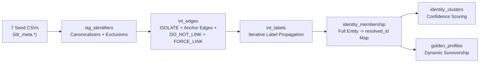

# Interfaces: CLI, Web UI, FastAPI, MCP Server & dbt

`sql-identity-resolution` provides five first-class interfaces that share the exact same underlying metadata model and graph resolution semantics.

---

## 1. Unified CLI Reference (`idr`)

| Command | Description | Example |
| :--- | :--- | :--- |
| `idr quickstart` | Generate synthetic retail data and run a complete local DuckDB resolution pipeline. | `idr quickstart --rows 10000 --output demo.duckdb` |
| `idr init` | Initialize `idr_meta`, `idr_work`, and `idr_out` schemas and tables (`--reset` recreates them). | `idr init --platform duckdb --db demo.duckdb` |
| `idr apply-config` | Compile and load a declarative YAML manifest into `idr_meta.*` tables. | `idr apply-config --db demo.duckdb --config config.yaml` |
| `idr run` | Execute the 8-stage resolution pipeline (`--mode FULL` or `--mode INCR`, `--dry-run`, `--strict`). | `idr run --db demo.duckdb --mode INCR --max-iters 30` |
| `idr privacy forget` | Execute GDPR/CCPA right-to-be-forgotten erasure by `--entity-key` or `--identifier-value`. | `idr privacy forget --db demo.duckdb --entity-key crm:101` |
| `idr ui` / `idr serve` | Launch the FastAPI backend and bundled React Web UI (`http://127.0.0.1:8000`). | `idr ui --db demo.duckdb --port 8000` |
| `idr mcp` | Launch the FastMCP server for Claude Desktop, Cursor, and AI coding agents. | `idr mcp --db demo.duckdb` |
| `idr dbt export` | Export YAML config or live warehouse `idr_meta.*` tables into the 7 `dbt_idr` seed CSVs. | `idr dbt export --file config.yaml --output-dir dbt_idr/seeds` |
| `idr status` | Print recent pipeline runs and summary statistics from `idr_out.run_history`. | `idr status --db demo.duckdb` |
| `idr inspect` | Inspect an entity key or cluster (`resolved_id`), its members, edges, and golden profile. | `idr inspect --db demo.duckdb --cluster crm:1` |

---

## 2. Interactive React Web UI (`idr ui`)

Launch the full-stack UI and API with a single command:

```bash
idr ui --db demo.duckdb
```

### Authentication Modes
- **Local Development Mode (Default for `idr ui`)**:
  - When bound to a loopback address (`127.0.0.1` / `localhost`), `idr ui` automatically enables `IDR_ALLOW_INSECURE_DEV_AUTH=true`, and the React SPA (`IDRAuthProvider.tsx`) activates local dev auth on loopback hosts when `VITE_AUTH_AUTHORITY` is not set.
- **Enterprise OIDC / JWT Mode (Production)**:
  - Set `IDR_AUTH_ISSUER`, `IDR_AUTH_AUDIENCE`, `VITE_AUTH_AUTHORITY`, and `VITE_AUTH_CLIENT_ID` (e.g., Keycloak, Okta, Auth0, Azure AD) to enforce Bearer JWT validation across all API routes.

### 6-Step Setup Wizard (`/setup`)
1. **Connect (`StepConnect`)**: Auto-discovers local DuckDB files, `gcloud` ADC projects, `~/.snowflake/connections.toml`, and `~/.databrickscfg` profiles, or accepts custom warehouse credentials.
2. **Discover (`StepDiscover`)**: Scans schemas and tables in your warehouse with fuzzy search and row count previews.
3. **Map (`StepMap`)**: Auto-detects `entity_key`, `watermark_column` (`updated_at`, `modified_at`, `order_date`, `event_ts`, etc.), identifiers, and attributes per source table.
4. **Rules & Exclusions (`StepRules`)**:
   - Configure deterministic rules with all 9 **Domain Canonicalizers** (`EMAIL_STANDARD`, `EMAIL_STRIP_PLUS`, `PHONE_DIGITS`, `PHONE_US_10`, `ALPHANUMERIC_UPPER`, `LOWERCASE`, `UPPERCASE`, `EXACT`/`NONE`) or a **Custom SQL (`{val}`)** expression input.
   - Toggle **Default Poison-Pill Exclusions (`use_default_exclusions`)** and add custom `EXACT`/`LIKE` or `ANY` wildcard exclusions.
5. **Survivorship (`StepSurvivorship`)**: Configure `PRIORITY`, `RECENCY`, or `FREQUENCY` winners per profile attribute.
6. **Review & Run (`StepReview`)**:
   - **Above-the-Fold Action Bar & Run Configuration**: Choose `Incremental (Faster)` or `Full Refresh`, `Max Iterations`, `Strict Mode`, or `Dry Run` and click **Save Config** or **Run Pipeline** without scrolling.
   - **Collapsible Summary Cards**: Click `Source Tables`, `Rules & Guardrails`, `Survivorship`, or `Raw JSON` to inspect configuration details in bounded drawers.
   - **Live 8-Stage Execution Progress**: Real-time progress bar (`GET /api/setup/run/progress`), elapsed timer, active stage indicator, and live Label Propagation iteration & label-change counter.

### Cluster Explorer & Stewardship (`/explorer`)
- Search by identifier value, `entity_key`, or `resolved_id` to inspect cluster graphs, confidence breakdowns, and Golden Profiles.
- **Stewardship Overrides Modal**: Create or delete `FORCE_LINK`, `DO_NOT_LINK`, and `ISOLATE` overrides directly from the UI.
- **GDPR Forget Entity Modal**: Purge an entity across all IDR tables with a single audited action.

---

## 3. FastAPI REST Endpoints (`idr_api`)

| Method & Path | Description |
| :--- | :--- |
| `POST /api/connect` | Connect to DuckDB, Snowflake, BigQuery, or Databricks and initialize session lease. |
| `GET /api/setup/AutoConfig` | Reconstruct the full declarative configuration from `idr_meta.*` tables (`sql_to_config`). |
| `POST /api/setup/save` | Validate and apply configuration (`config_to_sql`) to `idr_meta.*`. |
| `POST /api/setup/run` | Execute the 8-stage `IDRRunner` in a background worker thread and return `RunSummary`. |
| `GET /api/setup/run/progress` | Poll non-blocking in-memory stage progress (`stage_index`, `stage`, `iteration`, `changes`, `elapsed_seconds`). |
| `GET /api/clusters/{id}` | Retrieve cluster members, connecting edges, confidence breakdown, and Golden Profile. |
| `GET /api/explorer/overrides` | List active manual stewardship overrides from `idr_meta.identity_override`. |
| `POST /api/explorer/overrides` | Create a `FORCE_LINK`, `DO_NOT_LINK`, or `ISOLATE` override. |
| `DELETE /api/explorer/overrides/{id}` | Deactivate a manual stewardship override. |
| `POST /api/explorer/forget` | Execute GDPR/CCPA erasure via `PrivacyManager` and return the audit receipt. |
| `GET /metrics` | Prometheus metrics endpoint (`idr_entities_processed`, `idr_clusters_created`, `idr_run_duration_seconds`). |

---

## 4. FastMCP Server for AI Agents (`idr mcp`)

Expose your identity graph and configuration tools to Claude Desktop, Cursor, or any MCP client:

```json
{
  "mcpServers": {
    "sql-identity-resolution": {
      "command": "idr",
      "args": ["mcp", "--platform", "duckdb", "--db", "/absolute/path/to/demo.duckdb"]
    }
  }
}
```

### Exposed MCP Tools (`idr_mcp/server.py`)
- `get_ClusterView(resolved_id)` — Fetch cluster members, edges, confidence metrics, and golden profile attributes.
- `search_entities(query, limit)` — Search entities across all identifier types and attributes.
- `explain_edge(entity_a, entity_b)` — Explain which rules and normalized identifiers linked two entities.
- `list_runs(limit)` & `get_metrics()` — Inspect pipeline run history, skipped identifier groups, and cluster size distribution.
- `configure_source(...)`, `add_rule(...)`, `run_pipeline(run_mode, dry_run)` — Configure and run the pipeline via natural language.
- `export_dbt_seeds(output_dir, config_yaml)` — Compile YAML or live warehouse metadata into `dbt_idr` seed CSVs.

---

## 5. `dbt_idr` Package Integration

For teams that orchestrate transformations strictly through **dbt Core** or **dbt Cloud**, [`dbt_idr`](https://github.com/anilkulkarni87/sql-identity-oss/tree/main/dbt_idr) provides a pure-Jinja SQL implementation compatible with `dbt-duckdb`, `dbt-snowflake`, `dbt-bigquery`, and `dbt-databricks`.

### Exporting Config to dbt Seeds (`idr dbt export`)

You can design your rules in YAML or the Web UI and export all **7 standard `dbt_idr` seed CSVs** in one command:

```bash
# Export from YAML file
idr dbt export --file examples/config_retail.yaml --output-dir dbt_idr/seeds

# Or export directly from a live warehouse's idr_meta.* tables
idr dbt export --platform duckdb --db demo.duckdb --output-dir dbt_idr/seeds
```

### Generated Seed Files (`dbt_idr/seeds/`)
1. `idr_sources.csv` — Source table coordinates, `entity_key_column`, and `watermark_column`.
2. `idr_identifier_mappings.csv` — Source identifier columns (`EMAIL`, `PHONE`, `LOYALTY`, etc.).
3. `idr_attribute_mappings.csv` — Source attribute mappings for survivorship.
4. `idr_rules.csv` — Match rules, `canonicalize` strategy (`EMAIL_STANDARD`, `EMAIL_STRIP_PLUS`, `PHONE_US_10`, inline SQL `{val}`, etc.), and `max_group_size`.
5. `idr_exclusions.csv` — Default and custom exclusions (including `ANY` wildcard patterns).
6. `idr_survivorship_rules.csv` — `PRIORITY`, `RECENCY`, and `FREQUENCY` survivorship rules.
7. `idr_overrides.csv` — Manual stewardship overrides (`FORCE_LINK`, `DO_NOT_LINK`, `ISOLATE`).

### Running `dbt_idr`

```bash
cd dbt_idr
dbt seed
dbt run
dbt test
```

### `dbt_idr` Model DAG



